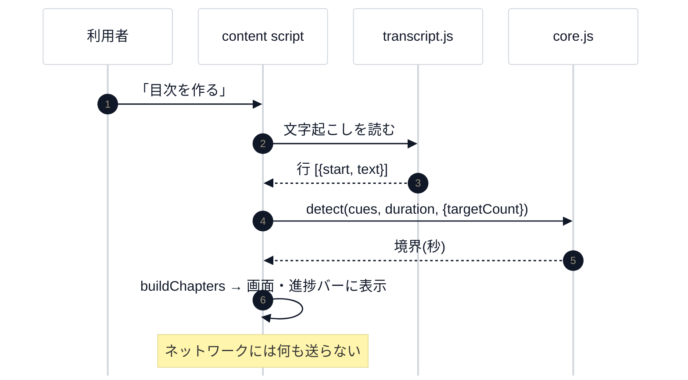
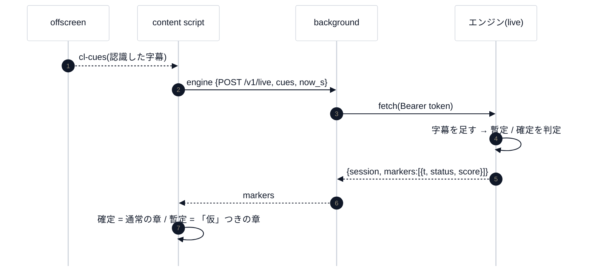
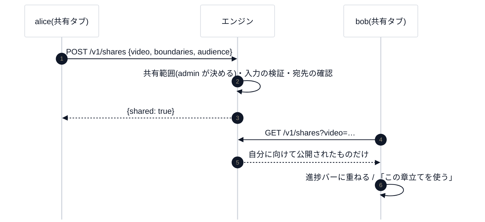

# 1. 全体像

## 1.1 一言で

**動画の「どこで何を話しているか」を、正確な時刻つきで出す**道具。主な入力は、YouTube の字幕(文字起こし)か、再生中のタブの音。
他人の動画は、**保存・切り出し・再配布しない**。残すのは、区間の時刻などの**派生データだけ**。

## 1.2 構成


| 部分 | 言語 | 役割 |
|---|---|---|
| **拡張**(`extension/`) | JavaScript(Manifest V3) | 目次の画面・字幕から作る検出(拡張の中で完結)・章の調整・ダイジェストの自動シーク |
| **エンジン**(`engine/`) | Python(標準ライブラリ中心) | HTTP サーバー(127.0.0.1)・音声認識・ライブ検出・利用者と共有・書き出し(CLI) |

## 1.3 段階(CH0〜CH6)



「**先に測れるようにしてから作る**」(CH0)が、全体の背骨です。数値はすべて**仮の目標**で、実測で決めます。

## 1.4 4 つの流れ

### ① 字幕から作る(拡張の中だけ)



### ② 音声から作る(エンジンを使う)

[第 7 回](../lecture/07-chrome-extension.md) のシーケンス図のとおり。popup が開始 → offscreen が音を受け取り 30 秒ごとに WAV にして `POST /v1/transcribe` → 結果を background 経由で content script へ → 時刻を動画の時刻に直して検出し直す。

### ③ ライブ



### ④ 共有



## 1.5 「区間と意味のデータ」(segments@1)

検出器を替えても、出力・表示は、この形だけを見る(版 `@1` は後方互換を保つ)。

```json
{
  "schema": "chapterlens/segments@1",
  "source": { "kind": "youtube", "id": "<video id>", "duration_s": 3612.4 },
  "segments": [
    { "start_s": 0.0, "end_s": 184.6, "title": "導入", "title_by": "rule",
      "confidence": 0.82, "status": "committed", "evidence": { "detector": "topic-shift@2" } }
  ],
  "provenance": { "engine": "0.1.0", "created": "2026-11-14T00:00:00Z" }
}
```

- `status`: `committed`(確定)/ `tentative`(暫定)。ライブで使う。
- `title_by`: 誰が題名を付けたか(`rule` / `llm` / `user`)。利用者の修正は、学習の元。

## 1.6 守る方針(設計書 §2・§10)

| 方針 | 実装 |
|---|---|
| 取得しない | 動画・音声を保存しない。読むのは、ページが見せている字幕と、利用者が操作したタブの音だけ |
| 共有は許可つき | 共有範囲(既定 off)・利用者の公開・宛先。共有するのは区間データだけ(サーバーが検証で強制) |
| 切り出しは自分の動画だけ | `--own`・URL 拒否・CLI だけ・上書き拒否 |
| 認可はサーバー側 | token から役割を引く。画面の出し分けは目安 |
| 権限は最小 | YouTube・127.0.0.1・利用者の操作のタブ音声だけ |

## 1.7 用語

[用語集](glossary.md) を引く。最初に覚える 6 語: **字幕(cue)・ビン・類似度の曲線・境界・章(チャプター)・確定 / 暫定**。

## 確認

- 4 つの流れを、図を見ずに、紙に描けるか。
- 「字幕から作る」で、データが拡張の外へ出ないことを、どのファイルで確かめられるか(ヒント: `extension.test.mjs` の通信の検査)。

次は [2. コードの読み方](02-code-tour.md)。
