# 2. コードの読み方

## 2.1 読む順番

迷ったら、この順で。**核(検出)→ 入口(CLI)→ サーバー → 拡張**。

```mermaid
%%{init: {"theme":"base","fontFamily":"Noto Sans JP, Hiragino Sans, Meiryo, sans-serif","themeVariables":{"fontFamily":"Noto Sans JP, Hiragino Sans, Meiryo, sans-serif","primaryColor":"#ffffff","primaryBorderColor":"#d0d5dd","primaryTextColor":"#101828","lineColor":"#667085","clusterBkg":"#f2f4f7","clusterBorder":"#d0d5dd","edgeLabelBackground":"#ffffff"},"flowchart":{"wrappingWidth":480,"nodeSpacing":40,"rankSpacing":56,"padding":14},"sequence":{"mirrorActors":false,"wrap":false,"width":150,"actorMargin":30,"messageMargin":34}}}%%
flowchart LR
    A["captions.py<br/>text.py"]:::input --> B["detectors/topic_shift.py"]:::input --> C["schema.py"]:::proc --> D["cli.py"]:::proc --> E["server.py"]:::out --> F["extension/src/<br/>core.js → content.js"]:::stop
    classDef input fill:#dae8fc,stroke:#1a73e8,color:#101828
    classDef proc fill:#e6f4f1,stroke:#0f9d8a,color:#101828
    classDef out fill:#fff7ed,stroke:#e8710a,color:#101828
    classDef stop fill:#fef3f2,stroke:#d92d20,color:#101828
```

## 2.2 エンジン(`engine/src/chapterlens/`)

**層の規則**: 下の層は、上の層を知らない。**核は、サーバーも CLI も知らない**(import しない)。

| ファイル | 層 | 役割 | 副作用 |
|---|---|---|---|
| `captions.py` | 核 | 字幕(VTT・SRT・json3)の読み込み・自動字幕の重複除去 | ファイル読み(`parse_captions` だけ) |
| `text.py` | 核 | 分かち書き(かな・漢字は 2 つ組、英語は単語) | なし |
| `detectors/topic_shift.py` | 核 | 話題の切り替えの検出(v1・v2) | なし |
| `schema.py` | 核 | 区間と意味のデータ(`segments@1`) | なし |
| `live.py` | 核 | ライブの逐次検出(暫定 → 確定) | なし(メモリだけ) |
| `digest.py` | 核 | ダイジェスト(重要区間・一致率) | なし |
| `asr.py` | 核 | faster-whisper・単語の時刻・発話の頭 | モデル・GPU(任意の依存) |
| `export.py` | 核 | EDL・SRT/VTT・ffmpeg の引数・実行 | ffmpeg の起動(`render`・`probe` だけ) |
| `metrics.py` `baselines.py` `chapters.py` `evaluation.py` | 評価 | F1・基準・正解の読み込み・判定 | データの読み込み |
| `accounts.py` `sharing.py` `corrections.py` | サーバー | 利用者・共有・修正(SQLite) | DB |
| `audit.py` | サーバー | 監査ログ・レート制限 | ログのファイル |
| `live_sessions.py` | サーバー | ライブのセッション(メモリ・上限・期限) | なし |
| `server.py` | サーバー | HTTP(認証 → 制限 → 経路 → 役割) | ネットワーク |
| `cli.py` `cli_tools.py` | 入口 | `detect`・`eval`・`serve`・`admin`・`digest`・`live`・`export` | — |

### 迷わないための目印

- 「ここで何が決まるか」が知りたい → **`detect`**(`TopicShiftDetector.detect`)から読む。
- 「このエンドポイントはどこ」→ `server.py` の `_route`(経路の一覧が 1 か所に)。
- 「この数値はどこで決まった」→ `V2_PARAMS`(コメントに、決めた経緯)・`LiveParams`・`DIGEST` 定数。

## 2.3 拡張(`extension/src/`)

| ファイル | 役割 | 世界 |
|---|---|---|
| `core.js` | 検出・ダイジェスト・章の組み立て・調整の計算(**純粋**。Python と同じ結果) | どこでも |
| `transcript.js` | **ソース・アダプタ**: 文字起こしパネルを開いて読む。YouTube の画面の作りが変わると壊れるのは、**ここのセレクタだけ** | content |
| `ui.js` | 画面(Shadow DOM・3 つのタブ)。**状態を持たず**、渡された内容を描くだけ | content |
| `content.js` | 全体の制御(状態・流れ)。動画が変わると前の結果を捨てる | content |
| `store.js` | 動画ごとの調整の保存(`chrome.storage.local`・100 本まで) | content / 管理ページ |
| `engine.js` | エンジンの API を頼む口(経路・失敗の説明)。**ネットワークには触れない** | content / 管理ページ |
| `capture.js` | 音声の取り込みの、ブラウザ API に触れない部分(16kHz 化・チャンク・WAV・時計↔再生位置) | どこでも |
| `background.js` | offscreen の作成・メッセージの中継・**エンジン API の中継(許可リスト)** | service worker |
| `offscreen.js` `pcm-worklet.js` | タブの音を受ける(AudioWorklet)→ `capture.js` へ | offscreen |
| `popup.*` | 開始・停止・エンジンの URL・token | popup |
| `admin.*` | 共有と管理のページ | 拡張のタブ |

**読み方のコツ**: `content.js` は、`state`(1 本の動画の状態)と、そこから `render()` で画面を描く関数でできています。
状態が先で、画面は結果。`state` の項目(`cues`・`auto`・`manual`・`chapters`・`digest`・`share`・`live`)を押さえると、全体が読めます。

## 2.4 テストの置き場所

| 見たいもの | ファイル |
|---|---|
| 検出・評価・字幕の読み込み | `engine/tests/test_detector.py` `test_metrics.py` `test_parsing.py` `test_eval_cli.py` |
| サーバー | `test_server.py`(基本)`test_server_roles.py`(役割・共有・制限)`test_server_live.py`(ライブ) |
| 音声・書き出し | `test_asr.py` `test_export.py` |
| 拡張の核 | `extension/test/core.test.mjs`(golden を含む) |
| 拡張の流れ | `flow.test.mjs`(取り込み)`features.test.mjs`(調整・ダイジェスト・共有・ライブ・中継) |
| 画面 | `ui.test.mjs`(偽 DOM は `fakedom.mjs`) |
| 拡張の守り(権限・通信) | `extension.test.mjs` |
| 文書 | `engine/tests/test_docs.py` |

## 確認

- `server.py` の `_route` を開いて、`/v1/live` がどの関数に行くか、5 分で見つけられるか。
- `content.js` で、「調整した章が保存される」処理(`applyEdit`)が、どの関数を呼ぶか追えるか。

次は [3. 内側の仕組み](03-internals.md)。
