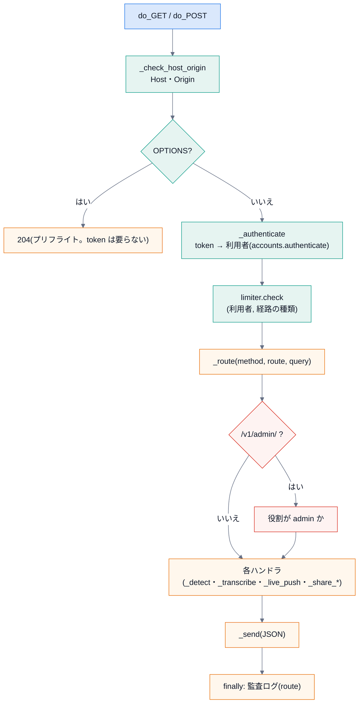
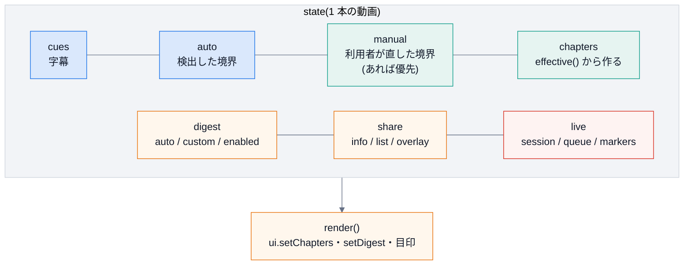

# 3. 内側の仕組み

## 3.1 エンジン: 1 つのリクエストの旅

`server.py` の `_dispatch` が、すべての呼び出しの入口です。順序が決まりです(順序を変えると、守りに穴が開きます)。

- 失敗は `HttpError(status, message)` で投げ、`_dispatch` が 1 か所で受けて JSON にする。**想定外の例外は `500`**で、内容は返さない。
- 認証に**失敗**した呼び出しは、レート制限を**数えない**(他人の枠を減らさせない)。
- 監査ログは `finally` で必ず書く(結果が何であっても)。

### 保存されるもの(`~/.chapterlens/` または `CHAPTERLENS_HOME`)

| ファイル | 中身 | 備考 |
|---|---|---|
| `token` | 管理者 `local` の token(平文) | **他人に見せない**。消すと作り直され、新しい token になる |
| `accounts.db` | 利用者・役割・**token のハッシュ**・設定(共有範囲) | |
| `corrections.db` | 利用者ごとの境界の修正 | `owner` で分離 |
| `shares.db` | 共有した区間データ | 字幕・音声は入らない |
| `audit.log`(`.1`) | 監査ログ | 5MB で 1 世代だけ回す |

ライブのセッションは**メモリだけ**(保存しない)。

## 3.2 検出の内部

[第 4 回](../lecture/04-topic-shift.md) の流れのとおり。**拡張の `core.js` が、同じ手順を持つ**。

- 入口: `TopicShiftDetector.detect` → `similarity_curve` → `select_boundaries`(平滑化・深さ・選択・snap・置き直し)。
- 途中の値を見たいとき: [第 4 回](../lecture/04-topic-shift.md) のように、各関数を直接呼ぶ(`similarity_curve`・`_depth_scores`)。
- 数値の決め方: `V2_PARAMS` のコメントと、`engine/tools/tune*.py`、評価の結果(`engine/README.md`)。

## 3.3 ダイジェストの内部

Python の `digest.py::select_digest` と、JavaScript の `core.js::selectDigest` が、**同じ手順**(実データ 39 本で一致)。
再生中の自動シークは、`core.js::digestNext(spans, t)` が「区間の中 → null / すき間 → 次の頭へ / 最後の後ろ → 終了」を返し、`content.js::digestTick` が `timeupdate` のたびに呼ぶ。

## 3.4 拡張: `content.js` の状態と描画

- **`effective()` = `manual ?? auto`**。利用者が直した境界があれば、それを優先する。
- 調整(`applyEdit`)→ `manual` を更新 → `store.saveManual` → `rebuild()`。粒度を変えると `auto` が変わるが、`manual` があるうちは**粒度を変えさせない**(黙って捨てない)。
- 取り込み中(`state.capture`)・ライブ中(`state.live`)は、**調整・ダイジェスト・共有を使えない**(`canEdit()`)。
- 動画が変わると `reset()` で、前の動画の状態を全部捨てる(取り込み・ライブも止める)。

### ブラウザに保存されるもの(`chrome.storage.local`)

| キー | 中身 |
|---|---|
| `chapterlens.engine` | エンジンの URL・token・言語(popup が保存) |
| `chapterlens.granularity` | 粒度 |
| `chapterlens.v.<動画 ID>` | その動画の調整(`manual` / `digest`)。**時刻だけ**(字幕・題名は保存しない) |
| `chapterlens.index` | 動画 ID の新しい順(100 本を超えると古いものを消す) |

## 3.5 ライブ

[第 11 回](../lecture/11-digest-and-live.md) の状態機械。拡張側は、`livePump` が字幕の待ち行列をエンジンへ 400 個ずつ送り、返ってきた `markers` を `applyLiveMarkers` で章にします。

- セッションが期限切れ(`404`)なら、**新しく始めて、いまある字幕を全部送り直す**(2 回まで)。
- 応答の形が想定と違っても、**例外にせず**、画面にエラーを出して、字幕の取り込みは続ける。

## 3.6 守りの層(まとめ)

| 層 | どこ | 何を防ぐ |
|---|---|---|
| ネットワーク | `127.0.0.1` だけで待ち受け | 外のネットワークからの接続 |
| ブラウザ | Host・Origin の検査 | DNS リバインディング・他サイトからの呼び出し |
| 認証 | token のハッシュ・定数時間の比較 | token の漏れ・タイミング攻撃 |
| 認可 | 役割はサーバーで引く | 画面の改ざん・名乗り |
| 制限 | 利用者ごと・経路の種類ごと | 連打・暴走 |
| 入力 | 検証(許可した項目だけ・上限) | 字幕の紛れ込み・巨大な入力 |
| 記録 | 監査ログ(内容を残さない) | 後から追えること・記録の漏れ |
| 拡張 | 権限最小・通信の許可リスト・`textContent` | 権限の乱用・XSS |
| 書き出し | `--own`・URL 拒否・CLI だけ | 他人の動画の切り出し |

次は [4. 拡張のしかた](04-extend.md)。
