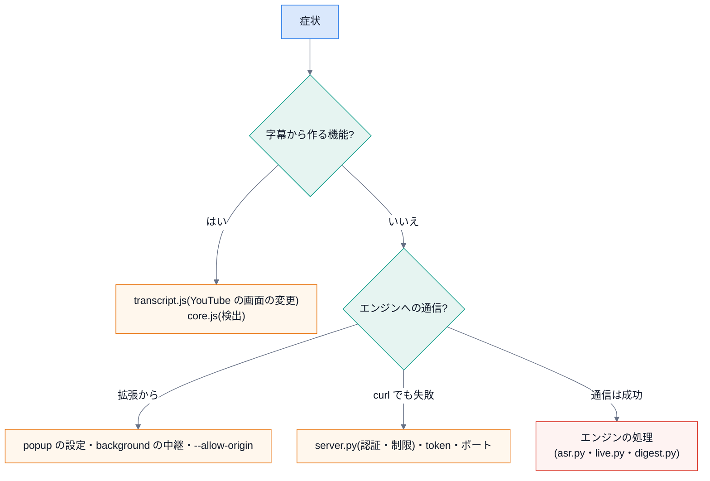

# 7. トラブルシュート

症状から、原因のファイルへ辿る表です。**まず、どの層か**を切り分けます。

## 拡張

| 症状 | 原因の候補 | 調べる・直す |
|---|---|---|
| 「この動画には文字起こしがないようです」 | その動画に文字起こしが無い / YouTube の画面の作りが変わった | 手動で「文字起こしを表示」が出るか。出るのにエラーなら `transcript.js` のセレクタ(**壊れるのはここだけ**) |
| 「文字起こしを開けませんでした」 | 読み込みが遅い・ボタンの位置が変わった | ページを再読み込み。それでも出るなら `transcript.js` |
| 目次が出ない・ボタンが出ない | 拡張が動画ページ(`/watch`)で動いていない | `chrome://extensions` でエラーを確認。`manifest.json` の `matches`・`run_at` |
| 章の位置が数秒〜十数秒ずれる | 自動字幕の時刻が粗い・話題の境界があいまい | 仕様。音声から作ると、発話の頭に寄る。**章は「候補」**。調整で直せる |
| 粒度を変えても変わらない | 直した章(`manual`)がある | 「自動に戻す」を押す |
| 調整が保存されない | `chrome.storage` が使えない / 動画 ID が読めない | 拡張のサービスワーカーのコンソール。`store.js` は、失敗しても画面は動く設計 |
| 「エンジンの接続設定がありません」 | popup で URL・token を保存していない | アイコン → URL(`http://127.0.0.1:8787`)と token を入れて、一度「始める」 |
| 「エンジンに接続できません」 | エンジンが起動していない・ポートが違う | `uv run python -m chapterlens serve` を確認。`--port` |
| 「この拡張を許可していません」(`origin`) | `--allow-origin` が無い・拡張 ID が違う | `chrome-extension://egcgicajchobpecnggcblcbnoadlnfai`。ID は `manifest.json` の `key` で固定 |
| 「token が違います」 | token が違う・停止された | `~/.chapterlens/token`。管理者に再発行(`admin rotate`) |
| 音声から作ると章が出ない | 再生していない・90 秒に満たない・音が無い | 再生中の長さ 90 秒以上が要る。**音が出ていない(無音の)動画**は認識できない |
| ライブなのに「音声の取り込みを始めました」と出る | ライブと判定されていない | `content.js::isLiveVideo`(`video.duration` が有限でなく、`.ytp-live` が無い)。YouTube の画面の作りを確認 |
| ライブの「仮」が消える | 取り下げ(脱線だった) | 仕様(取り下げ率 約 0.23)。`LiveParams` の `tentative_sim` を上げると減るが、取りこぼす |

## エンジン

| 症状 | 原因の候補 | 調べる・直す |
|---|---|---|
| `401` | token が違う・停止中(区別しない) | token・`admin users` で状態 |
| `403` Host / Origin | `localhost` 以外の名前で呼んでいる / Origin 未許可 | `127.0.0.1` で呼ぶ。`--allow-origin` |
| `403` 「管理者だけ」 | 利用者の token で管理の経路 | 管理者の token(`~/.chapterlens/token`)で |
| `403` 「共有は管理者が無効」 | 共有範囲が `off`(既定) | `admin share-mode team` |
| `429` | レート制限(通常 240/分・音声 30/分・管理 60/分) | `Retry-After` の秒を待つ。`DEFAULT_RATE_LIMITS` |
| `501` 音声認識 | faster-whisper が入っていない | `uv sync --extra asr` |
| 音声認識が遅い・GPU を使わない | CUDA のライブラリが無く CPU に落ちた | `/v1/transcribe` の応答の `device`(`cuda/float16` か `cpu/int8`)。`asr.py::_cuda_ok` |
| `413` | 音声が大きすぎる(既定 300MB)・字幕が多すぎる | `--max-audio-mb`。ライブは 1 回 500 個まで |
| ライブが `404` | セッションの期限切れ(2 時間)・他の利用者の ID | 拡張は自動で作り直す。API なら session を付けずに始める |
| 書き出しで「ffmpeg が見つかりません」 | PATH に無い | `ffmpeg`・`ffprobe` を入れる |
| 書き出しで「同じ名前のファイルがあります」 | 上書き拒否 | 別の名前か `--overwrite` |
| 日本語の字幕が四角(□)になる | フォントが無い | `--font "Yu Gothic"` など、入っているフォント名 |
| DB が壊れた・初期化したい | — | サーバーを止めて、`~/.chapterlens/*.db` を退避。**`token` を消すと管理者 token が作り直される** |

## テスト・文書

| 症状 | 原因の候補 | 直し方 |
|---|---|---|
| `test_docs` の「引用が今のソースと違う」 | コードを変えた | `python tools/quote_code.py docs` |
| 「実行に失敗」「出力が記述と違う」 | コードの挙動が変わった・実行ごとに変わる出力 | `--outputs` で作り直す。ランダムな値は出力しない |
| 「リンク先がない」 | ファイルの移動・名前の変更 | リンクを直す |
| Mermaid が標準の行で始まらない | 図を足した | `docspipeline check-mermaid --fix`(DocsPipeline) |
| Mermaid が描かれない | 構文の誤り | `mmdc -i 図.mmd -o 図.svg` で構文を確かめる |

## それでも分からないとき

1. **再現する最小の入力**を作る(合成の字幕・数行の呼び出し)。
2. その層のテストを走らせ、**どこから落ちるか**を見る。
3. 監査ログ(`admin audit`)で、経路・結果・所要時間を見る(内容は残っていない)。
4. [設計書](../../ChapterLens_DESIGN.md) の該当の段階・方針に戻って、**意図**を確かめる。

次は [8. メンテナンス](08-maintenance.md)。
