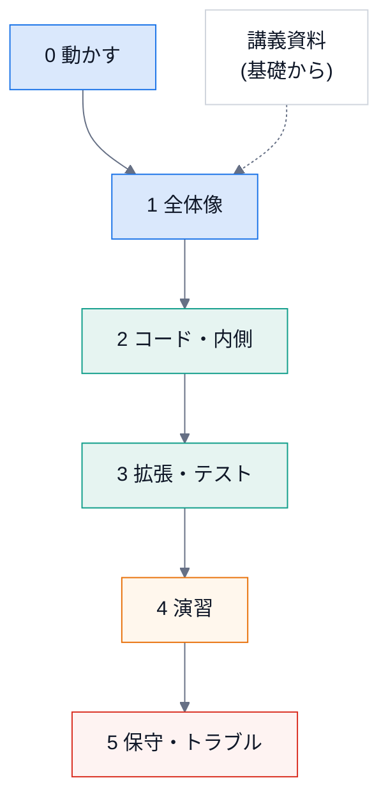

# 学習資料(保守・拡張の実務編)

ChapterLens を **保守し、拡張できるようになる** ための資料。使うだけなら [README](../../README.md) で足ります。
ここは「中を読んで、直して、足せる」人向けです。

## 目的

- 全体の仕組みを、図で説明できるようになる。
- どのファイルを、どの順で読めばよいかが分かる。
- 新しい検出器・API・画面・書き出し形式を、**テストつきで**足せる。
- 壊れたときに、症状から原因のファイルへ辿れる。

## 進め方



| 段階 | 読むもの | 目安 | できるようになること |
|---|---|---|---|
| 0 | 動かす(下) | 30 分 | テストを走らせ、拡張を Chrome に読み込める |
| 1 | [全体像](01-overview.md) | 1 時間 | 「字幕から / 音声から / ライブ / 共有」の流れを説明できる。用語が分かる |
| 2 | [コードの読み方](02-code-tour.md)、[内側の仕組み](03-internals.md) | 3 時間 | 好きなモジュールを、迷わずに開ける。処理の順序を追える |
| 3 | [拡張のしかた](04-extend.md)、[テストの書き方](05-testing.md) | 3 時間 | レシピどおりに、小さな機能を足せる |
| 4 | [演習](06-exercises.md) | 半日〜 | 答えの無い課題を、自分で設計して実装できる |
| 5 | [トラブルシュート](07-troubleshooting.md)、[メンテナンス](08-maintenance.md) | 随時 | 症状から原因を探せる。依存・YouTube の変更に対応できる |
| (基礎から) | [講義資料](../lecture/index.md) | 全 15 回 | 段階 1〜5 の**前**に読むと楽。Python・TF-IDF・検出・拡張・音声・安全・テストを、基礎から |
| (引く) | [用語集](glossary.md) | — | 分からない言葉が出たとき |

## まず動かす

```bash
cd engine
uv sync
uv run pytest -q                       # エンジンのテスト(文書の検査を含む)
```

```bash
cd extension
npm test                               # 拡張のテスト
```

Chrome に読み込む: `chrome://extensions` → 「デベロッパー モード」→「パッケージ化されていない拡張機能を読み込む」→ `extension/` を選ぶ。
音声から作る・ライブを使うときは、エンジンを起動します(手順は [README](../../README.md))。

## 使うときの注意

- 手を動かしながら読む。`# 実行できる` の例は、そのまま貼って実行できる(`engine/` で `uv run python`)。
- 実際の Chrome・本物のライブ配信での動作は、**未確認**の部分があります(各 README の「確認の範囲」)。

## 関連

- [設計書](../../ChapterLens_DESIGN.md) — なぜこの形にしたか(段階・基準・方針)
- [講義資料](../lecture/index.md) — 基礎から学ぶ(この資料は、その「実務編」)
