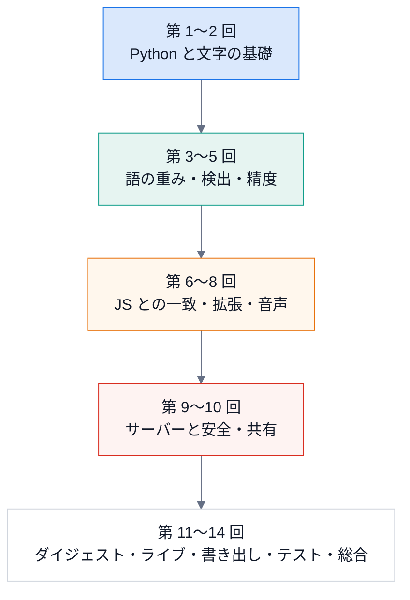

# 第 0 回 はじめに — 何を作っていて、どう読むか

> 所要時間の目安: 1 時間 / 前提: なし

## この回のゴール

- ChapterLens が **何を解決する道具か** を、1 分で説明できる。
- 全体が「**拡張(ブラウザ)** と **エンジン(この PC の Python)**」の 2 つでできていること、それぞれの役割が分かる。
- フォルダの地図を持ち、「どのファイルに何があるか」を探せる。
- 手元で **動かし、テストを走らせられる**。

## 1. 何を解決するか

YouTube の長い講義やチュートリアル動画では、「あの話はどこだったか」を探すのに時間がかかります。
投稿者がチャプター(目次)を付けていない動画も多くあります。

ChapterLens は、**動画の字幕(または音声の認識結果)から、話題が切り替わる時刻を自動で見つけて**、
目次を付けます。拡張が動画ページに目次を重ねて表示し、クリックでその位置へ飛べます。

| 入力 | 処理する場所 | 段階 |
|---|---|---|
| ページの文字起こし(字幕) | **拡張の中だけ**(何も送信しない) | CH1 |
| 再生中のタブの音(字幕が無いとき) | この PC の**エンジン**(127.0.0.1) | CH2 |
| ライブ配信の音 | エンジン(暫定の印 → 確定) | CH5 |

ほかに、重要な区間だけを自動で飛ばして見る「ダイジェスト」(CH4)、少人数での章立ての共有(CH3)、
**自分の動画だけ**を切り出す書き出し(CH6)があります。他人の動画を保存・切り出し・再配布する機能は、**作らない方針**です。

## 2. 全体の構成


- **拡張**(`extension/`): JavaScript。Chrome の中で動き、目次の画面を出す。字幕から作る検出は、拡張の中で完結する。
- **エンジン**(`engine/`): Python。この PC の `127.0.0.1` だけで待ち受ける小さな HTTP サーバーと、音声認識・ライブ検出・書き出し。
- **同じ検出を 2 回書いている**: 拡張(JavaScript)とエンジン(Python)で、**同じ入力に同じ結果**を返す。
  なぜそうするのか・どう保証するのかは第 6 回。

## 3. フォルダの地図

```text
ChapterLens/
├── engine/                 Python のエンジン
│   ├── src/chapterlens/    本体(検出器・サーバー・ASR・ライブ・ダイジェスト・書き出し)
│   ├── tests/              pytest(文書の検査も含む)
│   ├── tools/              調整・golden の書き出しなどの道具
│   └── dataset/            評価データ(git に入れない。他人の字幕を含む)
├── extension/              Chrome 拡張(Manifest V3)
│   ├── src/                content / background / offscreen / popup / admin ほか
│   ├── test/               Node の標準テスト(node:test)
│   └── tools/              モックのページ・実エンジンに通す確認
├── docs/                   この文書(learn/ lecture/ diagrams/)
└── tools/                  図の生成・引用の検査
```

## 4. 動かす

```bash
cd engine
uv sync                      # 依存を入れる(標準ライブラリ中心。音声認識だけ `--extra asr`)
uv run pytest -q             # テスト
```

```bash
cd extension
npm test                     # 拡張のテスト(依存なし。Node の標準機能だけ)
```

Python から、最小の検出を呼んでみます。`Cue` は「開始秒・終了秒・文」の 3 つ組で、字幕 1 行です。
前半 300 秒はギターの話、後半はお菓子作りの話、という合成の字幕を作り、話題の切り替えを探します。

```python
# 実行できる
from chapterlens.captions import Cue
from chapterlens.detectors import get_detector

A = ["guitar", "string", "chord", "melody", "tuning", "plectrum", "fretboard", "rhythm"]
B = ["recipe", "vegetable", "knife", "broth", "miso", "saucepan", "simmer", "seasoning"]

cues = []
for k, t in enumerate(range(0, 600, 6)):
    words = A if t < 300 else B
    text = " ".join(words[(k + j * 3) % len(words)] for j in range(5))
    cues.append(Cue(float(t), float(t + 6), text))

detector = get_detector("topic-shift@2")
result = detector.detect(cues, 600.0)
print("境界(秒):", result.boundaries)
print("信頼度  :", result.scores)
```

```text
# 出力
境界(秒): [240.0, 300.0]
信頼度  : [0.097, 1.0]
```

境界が 2 つ出ました。本当の切り替え(300 秒)は**信頼度 1.0**、240 秒の候補は **0.097** と、ごく弱い候補です。
信頼度は「いちばん深い谷を 1 とした、相対の深さ」(第 4 回)で、弱い候補は無視できます。
境界の数を指定すると(`target_count`)、深い順にその数だけ選びます。

```python
# 実行できる
from chapterlens.captions import Cue
from chapterlens.detectors import get_detector

A = ["guitar", "string", "chord", "melody", "tuning", "plectrum", "fretboard", "rhythm"]
B = ["recipe", "vegetable", "knife", "broth", "miso", "saucepan", "simmer", "seasoning"]
cues = []
for k, t in enumerate(range(0, 600, 6)):
    words = A if t < 300 else B
    cues.append(Cue(float(t), float(t + 6), " ".join(words[(k + j * 3) % len(words)] for j in range(5))))

one = get_detector("topic-shift@2").detect(cues, 600.0, target_count=1)
print("1 つだけ選ぶ:", one.boundaries)
```

```text
# 出力
1 つだけ選ぶ: [300.0]
```

この「個数を決めて選ぶ」使い方が、拡張の**粒度**(粗い・標準・細かい)の正体です。

## 5. この講義の進み方



- 各回は「ゴール → 本文(実行できる例つき)→ 確認問題 → 解答 → まとめ」の形です。
- `# 実行できる` のコードは、テストが実際に走らせて、出力が書いてあるとおりか確かめています。**手で写した出力はありません**。
- `# 引用:` のコードは、ソースから自動で作っています。コードが変わると、テストが失敗して気づけます。

## 確認問題

1. 字幕がある動画で目次を作るとき、データは拡張の外へ出ますか。
2. エンジンが待ち受けるアドレスは何で、なぜ外のネットワークからは届かないのですか。
3. 話題の切り替えの検出が、拡張と Python の両方にあるのはなぜですか(予想でよい)。

## 解答

1. 出ません。字幕から作る検出は拡張の中だけで完結し、ネットワークには何も送りません。
2. `127.0.0.1`(ループバック)だけです。このアドレスは「この PC 自身」を指し、外のネットワークからは接続できません。
3. 字幕が無い動画・ライブ・共有などでは Python のエンジンが必要で、字幕だけで済む場合は、エンジンを起動しなくても使えるように拡張の中にも置いたためです(第 6 回)。

## まとめ

- ChapterLens は、字幕(または音声の認識結果)から話題の切り替えを見つけ、目次を付ける道具。
- 拡張(JavaScript)とエンジン(Python)の 2 つ。字幕から作る処理は拡張の中だけで完結する。
- 他人の動画の保存・切り出し・再配布はしない。書き出しは自分の動画だけ。
- 次の回は、この道具で使う Python の基礎(第 1 回)。
