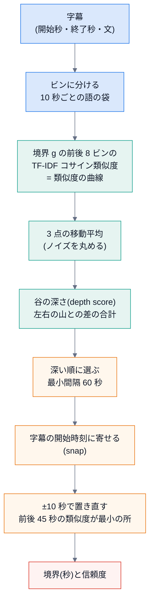

# 第 4 回 話題の切り替えを見つける(TextTiling 系の検出)

> 所要時間の目安: 4 時間 / 前提: 第 3 回

## この回のゴール

- 検出の**全手順**(ビン分け → 類似度の曲線 → 平滑化 → 谷の深さ → 選択 → 寄せる → 置き直し)を、図と数値で説明できる。
- `similarity_curve`・`_depth_scores`・`select_boundaries` を読んで、各引数の役割が分かる。
- パラメータ(`V2_PARAMS`)の意味と、**変えると何が起きるか**を予想できる。
- 「個数を指定する」モードと「自動」モードの違いを説明できる。

## 1. 全体の流れ



実装は `engine/src/chapterlens/detectors/topic_shift.py`。拡張の `core.js` が同じ手順を JavaScript で持ちます(第 6 回)。

## 2. 類似度の曲線

動画を 10 秒の**ビン**に分け、ビンごとに語を数えます。境界の候補 `g` は「ビン `g-1` とビン `g` の間」。
その**左の 8 ビン**(80 秒)と**右の 8 ビン**(80 秒)の、TF-IDF コサイン類似度を計ります(第 3 回)。

```python
# 引用: engine/src/chapterlens/detectors/topic_shift.py::similarity_curve
def similarity_curve(cues: list[Cue], duration_s: float, step_s: float, window_bins: int) -> list[float]:
    """語彙(TF-IDF)の類似度の曲線。curve[g - 1] = 境界 g(= g × step_s 秒)の前後の類似度。

    ビンが 3 未満・字幕が無いときは空のリスト。
    """
    nbins = num_bins(duration_s, step_s)
    if nbins < 3 or not cues:
        return []
    bins: list[Counter] = [Counter() for _ in range(nbins)]
    for cue in cues:
        bins[bin_index(cue.start_s, step_s, nbins)].update(term_counts(cue.text))

    df: Counter = Counter()
    for b in bins:
        df.update(b.keys())
    idf = {t: math.log((nbins + 1) / (n + 1)) + 1.0 for t, n in df.items()}

    def vector(window: list[Counter]) -> dict[str, float]:
        total: Counter = Counter()
        for b in window:
            total.update(b)
        return {t: (1.0 + math.log(c)) * idf[t] for t, c in total.items()}

    w = window_bins
    return [_cosine(vector(bins[max(0, g - w) : g]), vector(bins[g : g + w])) for g in range(1, nbins)]
```

- `bins[bin_index(...)].update(term_counts(...))` — 各字幕を、開始時刻のビンに入れる。
- IDF は**ビンを文書とみなして**数える(`nbins` が文書数)。
- 最後の行が本体。`bins[max(0, g - w) : g]` が左の窓、`bins[g : g + w]` が右の窓。端では窓が短くなります。
- 戻り値は `curve[g - 1]` = 境界 `g`(`g × 10` 秒)の前後の類似度。長さは `nbins - 1`。

3 つの話題が 200 秒ずつ続く合成の字幕で、曲線を見ます。

```python
# 実行できる
from chapterlens.captions import Cue
from chapterlens.detectors.topic_shift import similarity_curve, V2_PARAMS

A = ["guitar", "string", "chord", "melody", "tuning", "plectrum", "fretboard", "rhythm"]
B = ["recipe", "vegetable", "knife", "broth", "miso", "saucepan", "simmer", "seasoning"]
C = ["weather", "forecast", "typhoon", "humidity", "pressure", "rainfall", "temperature", "front"]
cues = []
for k, t in enumerate(range(0, 600, 6)):
    words = A if t < 200 else B if t < 400 else C
    cues.append(Cue(float(t), float(t + 6), " ".join(words[(k + j * 3) % len(words)] for j in range(5))))

p = V2_PARAMS
sims = similarity_curve(cues, 600.0, p.step_s, p.window_bins)
print("曲線の長さ:", len(sims), "(= ビン数 60 - 1)")
for g in (10, 15, 18, 20, 21, 25, 30):
    print(f"境界 {g * 10:3d} 秒: 類似度 {sims[g - 1]:.2f}")
```

```text
# 出力
曲線の長さ: 59 (= ビン数 60 - 1)
境界 100 秒: 類似度 1.00
境界 150 秒: 類似度 0.78
境界 180 秒: 類似度 0.55
境界 200 秒: 類似度 0.00
境界 210 秒: 類似度 0.20
境界 250 秒: 類似度 0.78
境界 300 秒: 類似度 1.00
```

話題が同じ範囲では類似度が **1.0 に近く**、本当の切り替え(200 秒)で、窓が**両側の話題をまたぐ**ため、谷になります。
最も低くなるのは、窓の左右がちょうど別の話題に分かれる位置です。

## 3. 平滑化と、谷の深さ

実際の字幕は、同じ話題の中でも類似度が上下します。**3 点の移動平均**(`_smooth`)で丸めてから、各点の**谷の深さ**を計ります。

```python
# 引用: engine/src/chapterlens/detectors/topic_shift.py::_depth_scores
def _depth_scores(sims: list[float]) -> list[float]:
    depths = []
    for i, s in enumerate(sims):
        left = i
        while left > 0 and sims[left - 1] >= sims[left]:
            left -= 1
        right = i
        while right < len(sims) - 1 and sims[right + 1] >= sims[right]:
            right += 1
        depths.append((sims[left] - s) + (sims[right] - s))
    return depths
```

- 各点 `i` から、**左へ**(値が下がらない限り)、**右へ**(同じく)山の頂上まで進む。
- 深さ = (左の山の高さ − `i` の高さ)+(右の山の高さ − `i` の高さ)。
- 「両側に高い山があって、自分だけ低い」点ほど、深い。**山が片側にしか無い**点(ただの下り坂)は、片側の差しか得られず、両側の谷より小さい。

```python
# 実行できる
from chapterlens.detectors.topic_shift import _smooth, _depth_scores

sims = [1.0, 1.0, 0.9, 0.2, 0.9, 1.0, 1.0]          # 4 つ目だけ谷
print([round(x, 2) for x in _depth_scores(sims)])
print([round(x, 2) for x in _depth_scores([1.0, 0.9, 0.8, 0.7, 0.6, 0.5, 0.4])])  # ただの下り坂
print([round(x, 2) for x in _smooth([1.0, 0.0, 1.0, 0.0, 1.0], 3)])                # ギザギザを丸める
```

```text
# 出力
[0.0, 0.0, 0.1, 1.6, 0.1, 0.0, 0.0]
[0.0, 0.1, 0.2, 0.3, 0.4, 0.5, 0.6]
[0.5, 0.67, 0.33, 0.67, 0.5]
```

- 谷のある列では、谷の位置が突出して大きい(両側の山が高い)。
- 下り坂 `[1.0, 0.9, … 0.4]` の深さは、坂の下ほど大きくなり(最大 0.6)、**谷(1.6)より小さい**。片側の山との差しか数えないため。
- 谷の深さは、両側の差を**足す**ので、「ここだけ落ちて、また戻る」形が、いちばん大きくなる。

## 4. 境界を選ぶ

`select_boundaries` が、深さのスコアから境界を選びます。

```python
# 引用: engine/src/chapterlens/detectors/topic_shift.py::select_boundaries
def select_boundaries(
    sims: list[float],
    cues: list[Cue],
    duration_s: float,
    p: TopicShiftParams,
    *,
    target_count: int | None,
    name: str,
    prepared: PreparedCues | None = None,
) -> Detection:
    """類似度の曲線から、境界を選ぶ(谷の深さ → しきい値 or 個数 → 最小間隔 → 置き直し)。"""
    meta = {"params": asdict(p), "target_count": target_count}
    if not sims:
        return Detection([], [], name, meta)
    nbins = len(sims) + 1
    depths = _depth_scores(_smooth(sims, p.smooth_bins))
    max_depth = max(depths) if depths else 0.0
    if max_depth <= 0:
        return Detection([], [], name, meta)

    cut_time = lambda g: g * p.step_s  # noqa: E731
    candidates = [
        (depths[g - 1], g)
        for g in range(1, nbins)
        if p.min_gap_s <= cut_time(g) <= duration_s - p.min_gap_s and depths[g - 1] > 0
    ]
    candidates.sort(reverse=True)

    if target_count is None:
        mean = sum(depths) / len(depths)
        std = math.sqrt(sum((d - mean) ** 2 for d in depths) / len(depths))
        threshold = max(mean + p.alpha * std, p.min_depth)
        candidates = [c for c in candidates if c[0] > threshold]
        limit = None
    else:
        limit = max(0, target_count)

    chosen: list[tuple[float, float]] = []  # (時刻, depth)
    starts = [c.start_s for c in cues]
    for depth, g in candidates:
        if limit is not None and len(chosen) >= limit:
            break
        t = snap(cut_time(g), starts, p.step_s)
        if all(abs(t - other) >= p.min_gap_s for other, _ in chosen):
            chosen.append((t, depth))

    chosen.sort()
    times = [t for t, _ in chosen]
    scores = [round(min(1.0, d / max_depth), 3) for _, d in chosen]
    if p.refine_radius_s > 0 and times:
        moved = refine_boundaries(times, prepared or PreparedCues(cues), p.refine_radius_s, p.refine_window_s, p.min_gap_s)
        if len(moved) == len(times):
            times = moved
        else:  # 最小間隔で落ちたものがある: 信頼度は先頭から揃える(順序は保たれる)
            times, scores = moved, scores[: len(moved)]
    return Detection([round(t, 3) for t in times], scores, name, meta)
```

読むポイント:

1. **候補**: 端から `min_gap_s`(60 秒)以内は除く。深さが正のものだけ。深い順に並べる。
2. **個数の決め方が 2 通り**
   - `target_count=None`(自動): しきい値 `max(平均 + alpha × 標準偏差, min_depth)` を超えたものだけ。
   - `target_count=k`: 深い順に**ちょうど k 個**(拡張の**粒度**はこちら)。
3. **最小間隔**: 選ぶたびに、すでに選んだ境界と `min_gap_s` 以上離れているかを確かめる。近いものは落とす。
4. **`snap`**: 計算上の時刻を、近くの字幕の開始時刻へ(第 1 回)。
5. **置き直し(refine)**: 各境界の前後 `±10` 秒の字幕の開始時刻のうち、**前後 45 秒の語の類似度が最小**の所へ動かす(粗い窓で見つけた谷の、細かい位置合わせ)。
6. **信頼度** = その境界の深さ ÷ **最大の深さ**(0〜1)。「いちばん深い谷を 1 とした相対値」。

```python
# 実行できる
from dataclasses import replace
from chapterlens.captions import Cue
from chapterlens.detectors.topic_shift import V2_PARAMS, similarity_curve, select_boundaries

A = ["guitar", "string", "chord", "melody", "tuning", "plectrum", "fretboard", "rhythm"]
B = ["recipe", "vegetable", "knife", "broth", "miso", "saucepan", "simmer", "seasoning"]
C = ["weather", "forecast", "typhoon", "humidity", "pressure", "rainfall", "temperature", "front"]
cues = []
for k, t in enumerate(range(0, 600, 6)):
    words = A if t < 200 else B if t < 400 else C
    cues.append(Cue(float(t), float(t + 6), " ".join(words[(k + j * 3) % len(words)] for j in range(5))))

sims = similarity_curve(cues, 600.0, V2_PARAMS.step_s, V2_PARAMS.window_bins)

def run(params, k):
    d = select_boundaries(sims, cues, 600.0, params, target_count=k, name="demo")
    return d.boundaries, d.scores

print("置き直しなし  :", run(replace(V2_PARAMS, refine_radius_s=0.0), None))
print("置き直しあり  :", run(V2_PARAMS, None))
print("1 つだけ(k=1):", run(V2_PARAMS, 1))
print("5 つ(k=5)    :", run(V2_PARAMS, 5))
```

```text
# 出力
置き直しなし  : ([198.0, 402.0], [1.0, 0.937])
置き直しあり  : ([204.0, 402.0], [1.0, 0.937])
1 つだけ(k=1): ([204.0], [1.0])
5 つ(k=5)    : ([204.0, 348.0, 468.0], [1.0, 0.095, 0.089])
```

- 置き直しなしでは、計算上の谷(200 秒・400 秒)を字幕の開始時刻へ寄せた値です。置き直しは、前後 45 秒の類似度が最小になる字幕の開始時刻へ、さらに動かします。
- `k=5` と指定しても、最小間隔 60 秒の制約と、深さが正の候補の数で、5 つに**満たない**ことがあります。「指定した個数ちょうど」を保証する値ではなく、**上限**です。

## 5. パラメータ(`V2_PARAMS`)

```python
# 引用: engine/src/chapterlens/detectors/topic_shift.py::TopicShiftParams
@dataclass
class TopicShiftParams:
    step_s: float = 10.0  # ビンの幅(秒)
    window_bins: int = 6  # 境界の前後の窓の大きさ(ビンの数)
    smooth_bins: int = 3  # 類似度の移動平均の幅(奇数)
    min_gap_s: float = 30.0  # 境界どうしの最小の間隔(秒)
    alpha: float = 0.5  # 自動のしきい値 = depth の平均 + alpha × 標準偏差
    # 自動のときの絶対の下限。相対のしきい値だけだと、話題が 1 つの動画でも「上位 30%」が境界になってしまう。
    # **仮の値**: 合成データではノイズが 0.4 以下・本物が 1.15 以上。実データの評価(CH0)で決め直す
    min_depth: float = 0.4
    # 置き直し(refine): 粗い窓で選んだ境界の近く(±radius)で、字幕 1 つ単位の細かい前後比較で位置を決め直す。0 = しない
    refine_radius_s: float = 0.0
    refine_window_s: float = 45.0  # 置き直しのときの、前後の窓の長さ(秒)
```

| パラメータ | 値(v2) | 変えると |
|---|---|---|
| `step_s` | 10 | ビンの幅。小さいと位置は細かいが、ビンあたりの語が少なく**不安定**。大きいと安定だが位置が粗い |
| `window_bins` | 8 | 前後の窓(80 秒)。大きいと**大きな話題の変わり目**だけ、小さいと細かい変化も拾う |
| `smooth_bins` | 3 | 曲線の移動平均。大きいと丸まり、小さな谷が消える |
| `min_gap_s` | 60 | 境界の最小間隔。小さいと細切れ(過分割)になる |
| `alpha` / `min_depth` | 0 / 0.1 | 自動モードのしきい値。大きいと境界が減る |
| `refine_radius_s` / `refine_window_s` | 10 / 45 | 置き直しの探す範囲・見る窓 |

**v1 と v2 の違い**は、`window_bins`(6→8)・`min_gap_s`(30→60)・`alpha`(0.5→0)・置き直しの有無です。
v2 は、**実データの調整用 10 本**で決め、確認用の別の 10 本で効果を見ました(経緯は `engine/README.md`)。調整の記録は、第 5 回で扱います。

## 6. 検出器を「差し替えられる口」にしている

`TopicShiftDetector` は `detect(cues, duration_s, *, target_count)` というメソッドを持つだけで、`register` で名前をつけて登録します。
サーバー・CLI・評価は、名前(`"topic-shift@2"`)で呼びます。新しい検出器を足す手順は [拡張のしかた](../learn/04-extend.md)。

## 確認問題

1. `similarity_curve` の戻り値の長さは、なぜ `ビン数 - 1` ですか。
2. 類似度の曲線が `[1.0, 0.9, 0.8, 0.7, 0.6]` のとき、各点の深さは `[0, 0.1, 0.2, 0.3, 0.4]` です。同じ高さの差でも、両側が山の谷より小さくなるのは、なぜですか。
3. 話題が頻繁に切り替わる動画で、`window_bins` を大きくすると、何が起きますか。
4. 信頼度が `0.097` の境界は、どう扱うのがよいですか。
5. `target_count=5` で、境界が 3 つしか返らないのは、どんなときですか。

## 解答

1. 境界は「隣り合うビンの間」にあり、`n` 個のビンには `n - 1` か所の間があるから。
2. 山が左にしか無い(右は下り続けるだけ)ため、数えられるのは**左の山との差だけ**。深さは「左右の山との差の**合計**」なので、両側に山がある谷(右の山との差も足される)より小さくなる。
3. 窓が広すぎて、短い話題が両側の話題に埋もれ、**細かい切り替えを見逃す**(大きな話題の境目だけが残る)。
4. 最大の谷の約 1 割の深さなので、**弱い候補**。しきい値(`min_depth`)や個数の指定で落とす。拡張は粒度で個数を決めて、弱い候補を表に出さない。
5. 最小間隔(60 秒)で、深い候補どうしが近くて落とされたとき、または、深さが正の候補が 3 つしか無かったとき。

## まとめ

- 検出は「類似度の曲線 → 谷の深さ → 深い順に選ぶ → 寄せる → 置き直す」。
- 谷とは、**両側が高い山で、自分だけ低い**点。ただの下り坂は谷ではない。
- 個数を決めて選ぶ(粒度)モードと、しきい値で自動に選ぶモードがある。
- パラメータは、**実データで調整し、別のデータで確かめて**決めた(次の回)。
