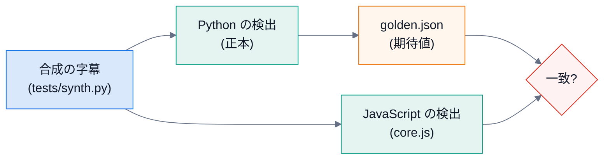

# 第 6 回 Python と JavaScript を「同じ結果」にする

> 所要時間の目安: 3 時間 / 前提: 第 4 回

## この回のゴール

- 同じアルゴリズムを 2 つの言語で持つ**理由と代償**を説明できる。
- 言語の違いで結果がずれる**典型的な落とし穴**(丸め・並べ替え・順序・浮動小数点)を挙げられる。
- **golden テスト**(Python の出力を期待値にして JavaScript を確かめる)の仕組みと、更新の手順が分かる。
- `core.js` の **UMD** という書き方(ブラウザでも Node でも動く)を読める。

## 1. なぜ 2 つあるのか

| | Python(エンジン) | JavaScript(拡張) |
|---|---|---|
| 字幕から作る | CLI・評価・サーバー | **拡張の中だけで完結**(何も送らない・エンジン不要) |
| 音声・ライブ・共有 | 必要 | 呼ぶだけ |

字幕がある動画で、わざわざエンジンを起動させたくない。かといって、評価・調整は Python で回したい。
だから**同じ検出を 2 回**書き、「**同じ入力には、同じ結果**」を契約にしました。代償は、**片方を直したら、もう片方も直す**手間と、ずれる危険です。

## 2. ずれる落とし穴

### 2.1 丸め

```python
# 実行できる
import math

for x in (0.5, 1.5, 2.5, 3.5):
    print(x, "Python round:", round(x), " 四捨五入(floor(x+0.5)):", math.floor(x + 0.5))
```

```text
# 出力
0.5 Python round: 0  四捨五入(floor(x+0.5)): 1
1.5 Python round: 2  四捨五入(floor(x+0.5)): 2
2.5 Python round: 2  四捨五入(floor(x+0.5)): 3
3.5 Python round: 4  四捨五入(floor(x+0.5)): 4
```

Python の `round` は**偶数への丸め**(2.5 → 2)ですが、JavaScript の `Math.round` は**四捨五入**(2.5 → 3)です。
ダイジェストの予算(区間の個数)は、両方で同じでなければならないので、Python 側を `math.floor(x + 0.5)` にして**揃えています**。

```python
# 引用: engine/src/chapterlens/digest.py::select_digest
def select_digest(
    cues: list[Cue],
    boundaries: list[float],
    duration_s: float,
    *,
    ratio: float = DEFAULT_RATIO,
    unit_s: float = UNIT_S,
) -> list[dict]:
    """重要な区間 [{start_s, end_s, score, chapter}](昇順・重ならない)を返す。字幕が無い・短すぎるときは空。"""
    n = math.ceil(duration_s / unit_s) if duration_s > 0 else 0
    if n < 2 or not cues or not (0 < ratio <= 1):
        return []

    unit_cues: list[list[Cue]] = [[] for _ in range(n)]
    counts: list[Counter] = [Counter() for _ in range(n)]
    for cue in cues:
        u = min(n - 1, max(0, int(cue.start_s // unit_s)))
        unit_cues[u].append(cue)
        counts[u].update(term_counts(cue.text))

    df: Counter = Counter()
    for c in counts:
        df.update(c.keys())
    idf = {t: math.log((n + 1) / (k + 1)) + 1.0 for t, k in df.items()}
    vectors = [{t: (1.0 + math.log(c)) * idf[t] for t, c in unit.items()} for unit in counts]

    info = []
    for v in vectors:
        s = 0.0
        for x in v.values():
            s += x
        info.append(s)
    top = max(info)
    if not top > 0:
        return []

    cuts = sorted(b for b in boundaries if 0 < b < duration_s)
    chapter = [bisect.bisect_right(cuts, (i + 0.5) * unit_s) for i in range(n)]  # 中間点で、どの章に入るか
    members: dict[int, list[int]] = {}
    for i, ch in enumerate(chapter):
        members.setdefault(ch, []).append(i)

    score = [0.0] * n
    for ch, idxs in members.items():
        total: dict[str, float] = {}  # 章の合計。「自分以外」は、ここから自分を引いて作る(長い章でも、かたまりの数に比例)
        for j in idxs:
            for t, x in vectors[j].items():
                total[t] = total.get(t, 0.0) + x
        for pos, i in enumerate(idxs):
            if info[i] <= 0:
                continue
            others = {}
            for t, x in total.items():
                rest = x - vectors[i].get(t, 0.0)
                if rest > REST_EPS:
                    others[t] = rest
            central = _cosine(vectors[i], others)
            score[i] = W_INFO * (info[i] / top) + W_CENTRAL * central + (W_LEAD if pos == 0 else 0.0)

    budget = max(1, math.floor(ratio * n + 0.5))  # 四捨五入(Python の round は偶数丸めで、JavaScript と食い違う)
    ranked = sorted((i for i in range(n) if info[i] > 0), key=lambda i: (-score[i], i))
    chosen: list[int] = []
    per_chapter = []  # 各章の最高点
    for ch in sorted(members):
        best = [i for i in ranked if chapter[i] == ch]
        if best:
            per_chapter.append(best[0])
    per_chapter.sort(key=lambda i: (-score[i], i))
    for i in per_chapter[:budget]:
        chosen.append(i)
    taken = set(chosen)
    for i in ranked:
        if len(chosen) >= budget:
            break
        if i not in taken:
            chosen.append(i)
            taken.add(i)
    picked = sorted(taken)
    if not picked:
        return []

    # 1 つだけ空いたすき間は埋める(細切れに飛ばない)→ 連続を 1 つの区間に
    groups: list[list[int]] = [[picked[0]]]
    for i in picked[1:]:
        if i - groups[-1][-1] <= 2:
            groups[-1].extend(range(groups[-1][-1] + 1, i + 1))
        else:
            groups.append([i])

    spans = []
    for g in groups:
        in_span = [c for u in g for c in unit_cues[u]]
        if not in_span:
            continue
        start = min(c.start_s for c in in_span)
        end = min(max(c.end_s for c in in_span), (g[-1] + 1) * unit_s + END_SLACK_S, duration_s)
        if end - start < MIN_SPAN_S:
            continue
        s = max(score[u] for u in g)
        spans.append({"start_s": round(start, 3), "end_s": round(end, 3), "score": round(min(1.0, s), 3), "chapter": chapter[g[0]]})
    # 区間どうしが重ならないように(最後のかたまりの延長で、次の区間の頭に食い込まない)
    for a, b in zip(spans, spans[1:]):
        if a["end_s"] > b["start_s"]:
            a["end_s"] = b["start_s"]
    return [s for s in spans if s["end_s"] - s["start_s"] >= MIN_SPAN_S]
```

上の `budget = max(1, math.floor(ratio * n + 0.5))` の行がそれです(コメントで理由を書いてあります)。JavaScript 側は同じ式です。

```javascript
// 抜粋ファイル: extension/src/core.js
    const budget = Math.max(1, Math.floor(o.ratio * n + 0.5));
```

### 2.2 並べ替えの同点

境界の候補を「深い順」に並べるとき、**同じ深さのとき、どちらを先にするか**で、選ばれる境界が変わります。Python は `candidates.sort(reverse=True)`(タプルなので、深さが同じなら `g` の大きい方が先)。
JavaScript の `sort` は比較関数を書かないと文字列順になるので、**Python と同じ順序になる比較関数**を書きます。

```javascript
// 抜粋ファイル: extension/src/core.js
    // Python の candidates.sort(reverse=True) と同じ: 深さの降順、同じなら g の降順
    candidates.sort((a, b) => b[0] - a[0] || b[1] - a[1]);
```

### 2.3 二分探索

Python には `bisect` がありますが、JavaScript には標準で無いので、**同じ意味で自作**します(第 1 回の `bisect_left` / `bisect_right`)。

```javascript
// 抜粋ファイル: extension/src/core.js
  function bisectLeft(a, x) {
    let lo = 0, hi = a.length;
    while (lo < hi) {
      const mid = (lo + hi) >> 1;
      if (a[mid] < x) lo = mid + 1;
      else hi = mid;
    }
    return lo;
  }
```

### 2.4 辞書の順序と、足し算の順序

浮動小数点の足し算は、**順序が変わると、最後の桁がずれる**ことがあります(`(a+b)+c` と `a+(b+c)`)。
Python の `dict` も JavaScript の `Map` も、**挿入した順に**並ぶので、同じ順に足せば、同じ結果になります。
そのため `core.js` は、`Map` に語を入れる順序を、Python の `Counter` と**同じに**してあります。

### 2.5 数学関数

`log` は、言語(と OS の数学ライブラリ)が違うと、**最後の 1 ビット**が違うことがあります。
そこで、テストは「**境界の時刻は完全一致**・**信頼度は 1e-3 以内**」と、期待を使い分けます。

## 3. golden テスト

**Python の出力を期待値(golden)として保存し、JavaScript の出力と突き合わせます。**



```python
# 実行できる
import json
from pathlib import Path
import chapterlens

root = Path(chapterlens.__file__).resolve().parents[3]          # ChapterLens/
golden = json.loads((root / "extension" / "test" / "golden" / "golden.json").read_text(encoding="utf-8"))
print("検出器:", golden["detector"])
for case in golden["cases"]:
    print(case["name"], "字幕", len(case["cues"]), "行 / 期待値の種類:", sorted(case["expect"]), "/ ダイジェスト:", sorted(case["digest"]))
```

```text
# 出力
検出器: topic-shift@2
en-6topics 字幕 467 行 / 期待値の種類: ['free', 'k3', 'k6'] / ダイジェスト: ['r0.2', 'r0.35']
ja-5topics 字幕 370 行 / 期待値の種類: ['free', 'k3', 'k6'] / ダイジェスト: ['r0.2', 'r0.35']
en-4topics 字幕 368 行 / 期待値の種類: ['free', 'k3', 'k6'] / ダイジェスト: ['r0.2', 'r0.35']
ja-single 字幕 225 行 / 期待値の種類: ['free', 'k3', 'k6'] / ダイジェスト: ['r0.2', 'r0.35']
en-short 字幕 43 行 / 期待値の種類: ['free', 'k3', 'k6'] / ダイジェスト: ['r0.2', 'r0.35']
```

- 合成データは、**他人の字幕を含まない**ので、git に入れてよい。
- **実データ(39 本)**は、他人の字幕を含むので git に入れず、手元でだけ突き合わせます(`extension/tools/parity_real.mjs`)。
  結果は、検出 78 通り・ダイジェスト 39 本が**完全一致**。

### 更新の手順

アルゴリズムを変えたら、次の順で作り直します。

```bash
cd engine
uv run python tools/export_golden.py all     # golden.json(合成)と、手元の実データの期待値を書き出す
cd ../extension
npm test                                     # JavaScript 側が追いついているか(落ちたら、core.js を直す)
node tools/parity_real.mjs                   # 実データでも一致するか(手元だけ)
```

**順序が大切**です。Python を先に直し、golden を作り直し、JavaScript を合わせる。逆にすると、「どちらが正しいか」が分からなくなります。

## 4. UMD: ブラウザでも Node でも動く書き方

拡張の content script は、ブラウザの `<script>` で読み込まれます(`import` が使えない)。一方、テストは Node で動かしたい。
そこで、**どちらでも動く**書き方(UMD)にします。

```javascript
// 抜粋ファイル: extension/src/core.js
(function (root, factory) {
  if (typeof module === "object" && module.exports) module.exports = factory();
  else root.ChapterLensCore = factory();
})(typeof self !== "undefined" ? self : this, function () {
```

- Node(`module.exports` がある)なら、`require("../src/core.js")` で取れる。
- ブラウザなら、`self.ChapterLensCore` というグローバルに置く(`content.js` が `window.ChapterLensCore` で使う)。
- `core.js` は DOM に触れない**純粋なロジック**だけにしてあるので、Node で**そのままテスト**できます。

## 確認問題

1. Python の `round(2.5)` と JavaScript の `Math.round(2.5)` は、それぞれいくつですか。
2. ダイジェストの予算の計算で、`round` を使わず `floor(x + 0.5)` にした理由は。
3. 境界の「時刻」は完全一致、「信頼度」は 1e-3 以内、と期待を分けるのはなぜですか。
4. アルゴリズムを変えたとき、golden を作り直す前に JavaScript を直してはいけないのはなぜですか。
5. 実データの期待値を git に入れないのはなぜですか。

## 解答

1. `2` と `3`。
2. 偶数への丸めと四捨五入で、個数が 1 つ違うと、**選ばれる区間が変わる**から。両方を同じ式にして揃えた。
3. 時刻は、字幕の開始時刻に寄せた値(離散的)なので完全一致を期待できる。信頼度は `log` を含む浮動小数点の計算なので、最後の桁が言語で違いうる。
4. 期待値が古いままだと、「古い期待値に合わせて直す」ことになり、正本(Python)とのずれが残るから。
5. 他人の字幕を含み、公開・再配布しない方針のため。

## まとめ

- 同じ検出を 2 つの言語で持つと、**どちらの結果が正しいか**を決める正本(Python)と、突き合わせるテスト(golden)が要る。
- ずれる原因は、丸め・並べ替えの同点・自作が要る関数・足し算の順序・数学関数の最後の桁。
- 更新は「Python → golden → JavaScript」の順。実データでも確かめる(手元だけ)。
- 次の回は、拡張(Manifest V3)の仕組み。
