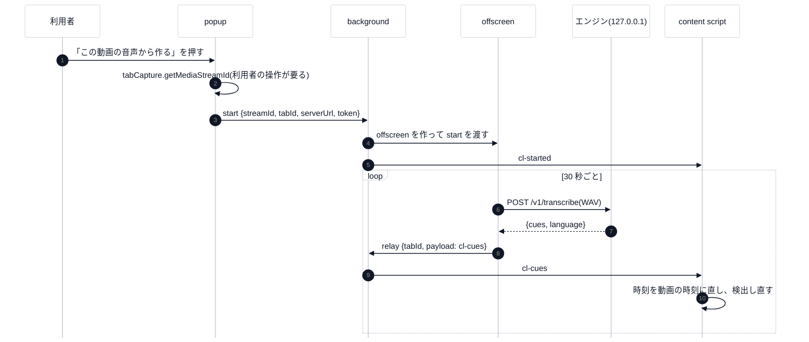

# 第 7 回 Chrome 拡張の仕組み(Manifest V3)

> 所要時間の目安: 4 時間 / 前提: 第 6 回

## この回のゴール

- Manifest V3 の拡張が、**どの部品に分かれ、どう会話するか**を説明できる。
- content script・service worker・offscreen document・popup の**役割の違い**と、「なぜ分かれているか」が分かる。
- **権限を最小にする**とはどういうことかを、`manifest.json` を読んで確かめられる。
- 拡張の**通信を 1 か所に閉じる**設計(許可リスト)を説明できる。

## 1. 部品と、その制約

拡張は 1 つのプログラムではなく、**別々の「世界」で動く部品**の集まりです。世界ごとに、できることが違います。


| 部品 | どこで動くか | できること | できないこと |
|---|---|---|---|
| **content script**(`content.js` ほか) | YouTube のページの中(**隔離された世界**) | ページの DOM を読む・画面を重ねる・`chrome.runtime` でメッセージを送る | ページの JS の変数は見えない。他のサイトへ `fetch` しない(方針) |
| **service worker**(`background.js`) | ブラウザの裏(必要なときだけ起動し、使われないと止まる) | 拡張の API 全般・`fetch`・メッセージの中継 | DOM が無い。**常駐しない**(状態を持てない) |
| **offscreen document**(`offscreen.js`) | 見えない HTML ページ | `getUserMedia`・`AudioContext`(音の処理) | 拡張の API が少ない |
| **popup**(`popup.js`) | アイコンを押したときの小さな画面 | `tabCapture` の開始(**利用者の操作が要る**) | 閉じると消える |
| **管理ページ**(`admin.js`) | 拡張の中の普通のタブ | メッセージを送って管理操作 | — |

- **なぜ offscreen が要るか**: Manifest V3 の service worker には DOM も `AudioContext` も無く、音を扱えません。
  そこで「見えない HTML ページ」を 1 つ作り、音の処理だけを任せます(`reasons: ["USER_MEDIA"]`)。
- **なぜ content script と background が分かれるか**: content script はページの中(信頼できないページと同じ場所)にあり、強い権限を持たせたくない。
  強い権限が要る操作(エンジンへの通信)は、**background に頼む**形にします。

## 2. メッセージで会話する

部品どうしは `chrome.runtime.sendMessage` / `chrome.tabs.sendMessage` で、**JSON のメッセージ**を送り合います。



- メッセージには `target`(宛先)と `type` を付け、**自分宛てでないものは無視**します。
- `chrome.runtime.sendMessage` は、**この拡張の中の部品だけ**に届きます(外部の拡張・ページからは送れない設定です)。

## 3. 権限を最小にする

```javascript
// 抜粋ファイル: extension/manifest.json
  "manifest_version": 3,
  "permissions": [
    "storage",
    "tabCapture",
    "offscreen",
    "activeTab"
  ],
  "host_permissions": [
    "http://127.0.0.1/*"
  ],
```

| 権限 | 使う理由 |
|---|---|
| `storage` | 粒度・調整・エンジンの URL と token の保存(この PC のブラウザの中だけ) |
| `tabCapture` + `activeTab` | 再生中のタブの音を取る(**利用者がアイコンを押したタブだけ**) |
| `offscreen` | 音を処理する見えない画面 |
| `host_permissions: 127.0.0.1` | **この PC のエンジンにだけ**通信する |
| content script の対象 | `https://www.youtube.com/*` だけ(**全サイトの読み取りは要求しない**) |

テストが、この権限が増えていないことを確かめています(`extension/test/extension.test.mjs`)。

```python
# 実行できる
import json
from pathlib import Path
import chapterlens

root = Path(chapterlens.__file__).resolve().parents[3]
m = json.loads((root / "extension" / "manifest.json").read_text(encoding="utf-8"))
print("権限         :", sorted(m["permissions"]))
print("通信できる先 :", m["host_permissions"])
print("読み込む対象 :", [c["matches"] for c in m["content_scripts"]])
print("読み込む順   :", [Path(f).name for f in m["content_scripts"][0]["js"]])
```

```text
# 出力
権限         : ['activeTab', 'offscreen', 'storage', 'tabCapture']
通信できる先 : ['http://127.0.0.1/*']
読み込む対象 : [['https://www.youtube.com/*']]
読み込む順   : ['core.js', 'capture.js', 'store.js', 'engine.js', 'transcript.js', 'ui.js', 'content.js']
```

読み込む順が大切です。`content.js` は `core.js`・`store.js` などに**依存**するので、最後に読み込みます(テストが順序を確かめます)。

## 4. 通信を 1 か所に閉じる

拡張が外へ出ていく道は、**`fetch` を呼ぶ場所**です。それを 2 か所だけにして、テストで見張ります。

- `offscreen.js`: 音声を `/v1/transcribe` へ送る。
- `background.js`: 共有・ライブ・管理の API を中継する。

`background.js` の中継は、**許可リスト**で経路を絞ります。

```javascript
// 抜粋ファイル: extension/src/background.js
const ENGINE_ROUTES = [
  ["GET", /^\/v1\/me$/],
  ["POST", /^\/v1\/me\/forget$/],
  ["POST", /^\/v1\/live$/],
  ["POST", /^\/v1\/admin\/users\/(local|u_[0-9a-f]{8})\/(disable|enable|rotate|purge|role)$/],
```

守りは重ねてあります。

1. 送り先は `127.0.0.1` だけ(`validateServerUrl`)。別のホストの設定なら、token も渡さずに拒否。
2. 経路は許可リストの 13 個だけ(音声の `/v1/transcribe`・`/v1/detect` は通さない)。
3. 呼べるのは**この拡張自身**(`sender.id`)だけ。
4. リダイレクトは辿らない(`redirect: "error"`)・Cookie は送らない(`credentials: "omit"`)。
5. token は、メッセージで受け取らず、**保存済みの設定から読む**。

## 5. 画面: Shadow DOM と `textContent`

content script が出す画面は、YouTube のページの中に入ります。ページの CSS に壊されず、ページを壊さないよう、**Shadow DOM** に閉じます。

- 文字は `textContent` だけで入れ、**`innerHTML` は使わない**(字幕や題名に `<script>` が含まれていても、ただの文字になる)。テストが、`innerHTML` の使用そのものを禁止しています。

## 確認問題

1. offscreen document が必要な理由を、service worker の制約から説明してください。
2. 拡張が外へ出る `fetch` を 2 か所に限る利点は何ですか。
3. `content_scripts` の `matches` を `<all_urls>` にしない理由は。
4. `tabCapture` を popup から始めるのは、なぜですか。
5. 許可リストに無い経路(`POST /v1/transcribe`)を `background.js` の中継で呼ぶと、何が返りますか。

## 解答

1. service worker には DOM も `AudioContext` も無く、音を扱えない。音の処理を、見えない HTML ページ(offscreen)に任せるため。
2. 外へ出る道が少なく、**テストで見張りやすい**。送り先の検査・token の扱いを 1 か所に集められる。
3. 全サイトの内容を読む権限を持たせないため(最小権限)。YouTube だけに絞ると、利用者の不安も、攻撃される面も小さい。
4. `tabCapture` は、**利用者の操作(アイコンのクリック)が要る** API だから。勝手に音を取れないようにする、ブラウザ側の守り。
5. `{ok: false, code: "forbidden", error: "許可していない経路です"}` が返り、通信はしない(テスト済み)。

## まとめ

- 拡張は、世界の違う部品(content script・service worker・offscreen・popup)がメッセージで会話する。
- 強い操作は background に頼み、ページの中の部品には強い権限を持たせない。
- 権限は最小(YouTube・127.0.0.1・利用者の操作のタブ音声だけ)。通信は 2 か所に閉じ、許可リストで絞る。
- 次の回は、音(PCM)の基礎と、タブの音を文字にするまで。
