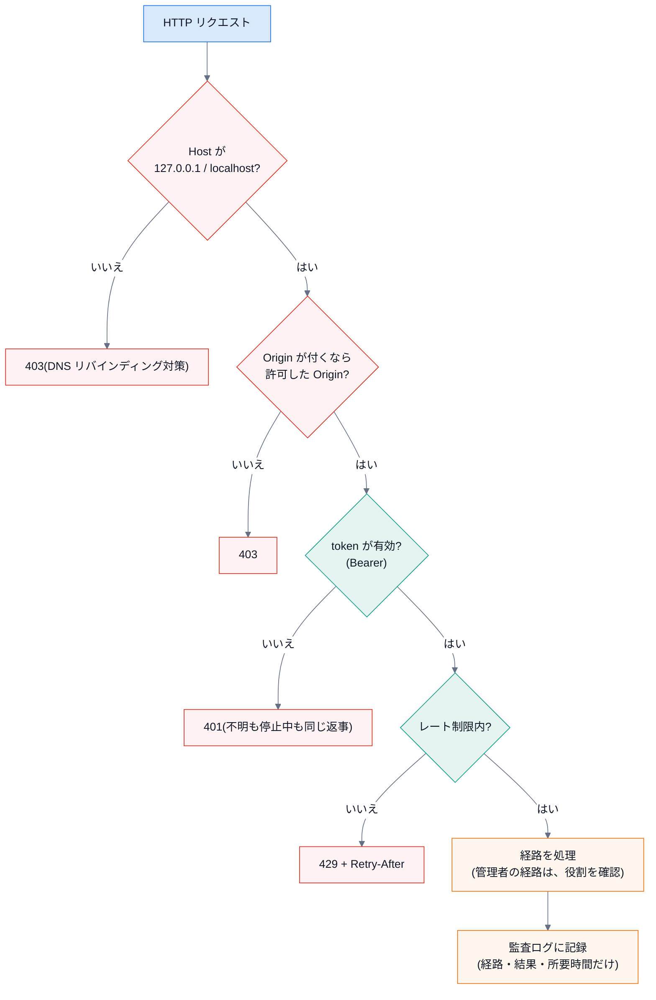

# 第 9 回 ローカルサーバーと安全設計

> 所要時間の目安: 4 時間 / 前提: 第 7 回

## この回のゴール

- HTTP の**リクエスト → 処理 → レスポンス**の流れと、`127.0.0.1` で待ち受ける意味を説明できる。
- **token をハッシュで保存する**理由と、**定数時間の比較**の意味が分かる。
- **Host・Origin の検査**が、何の攻撃(DNS リバインディング・他サイトからの呼び出し)を防ぐか説明できる。
- **レート制限**(スライディング窓)と**監査ログ**の設計を、コードで読める。
- 「守りは**サーバー側**に置く」という原則を説明できる。

## 1. ローカルサーバーという選び方

拡張からエンジンを呼ぶ方法は、**Native Messaging**(標準入出力)か、**localhost の HTTP**です。
ChapterLens は HTTP を選びました(CLI・テスト・拡張が**同じ入口**で呼べる)。代わりに、HTTP の守りを自分で書きます。

- **`127.0.0.1` だけ**で待ち受ける(`0.0.0.0` にしない)。このアドレスは「この PC 自身」で、**外のネットワークから届かない**。
- ただし、**同じ PC のブラウザで開いた、悪い Web サイト**は、`127.0.0.1` に向けて通信を試みられます。だから、さらに守ります。

## 2. 1 つのリクエストが通る関門



順序にも意味があります。**認証に失敗した呼び出しが、他人のレート制限の枠を減らさない**ように、認証のあとに制限を数えます。

## 3. Host と Origin

| ヘッダ | 何を表すか | 検査の目的 |
|---|---|---|
| `Host` | 呼ばれたサーバー名 | **DNS リバインディング**(悪いサイトの名前を、一時的に `127.0.0.1` に向ける攻撃)で、`evil.com` の名前のまま来る呼び出しを拒否 |
| `Origin` | 呼び出した**ページの出どころ** | ブラウザが付ける。`chrome-extension://<ID>` のような**許可した Origin**だけ通す。何も許可しなければ、ブラウザからは呼べない |

`Origin` が付かない呼び出し(`curl`・CLI)は、ブラウザ経由ではないので、token だけで通ります。

## 4. token とハッシュ

利用者は **token**(256 ビットの乱数)で本人を示します。サーバーは、token そのものを**保存しません**。

```python
# 引用: engine/src/chapterlens/accounts.py::hash_token
def hash_token(token: str) -> str:
    return hashlib.sha256(token.encode("utf-8")).hexdigest()
```

- 保存するのは **SHA-256 のハッシュ**。ファイルが漏れても、ハッシュから token は(現実的には)復元できません。
- 作成時に**1 度だけ**表示する(忘れたら、再発行)。
- token は 256 ビットの乱数なので、パスワードのような**遅いハッシュ**(bcrypt など)は要りません(総当たりが成り立たない)。

```python
# 引用: engine/src/chapterlens/accounts.py::AccountStore.authenticate
def authenticate(self, token: str) -> dict | None:
    """token から利用者を引く。無効化された利用者・不明な token は None(区別して返さない)。全員と比べて、早く終わらない。"""
    if not token:
        return None
    h = hash_token(token)
    found = None
    with self._lock:
        rows = self.db.execute("SELECT id, name, role, disabled, created_at, token_hash FROM users").fetchall()
    for r in rows:
        if hmac.compare_digest(h, r[5]) and found is None:
            found = r
    if found is None or found[3]:
        return None
    return _public(found[:5])
```

読むポイント:

1. **全員と比べる**: 見つかっても `break` しません。**早く終わると、応答時間から「何人目か」が漏れる**(タイミング攻撃)。
2. `hmac.compare_digest` は**定数時間**の比較(最初の違う文字で止まらない)。
3. **停止中の利用者も、不明な token も、同じ `None`**。外から見て区別できない(「その token は存在する」と教えない)。

```python
# 実行できる
from chapterlens.accounts import AccountStore, hash_token

store = AccountStore()                      # メモリ上
user, token = store.create_user("alice")
print("作った利用者:", user["id"].startswith("u_"), user["role"])
print("token の長さ:", len(token), "文字(", "表示は 1 度だけ )")
print("保存されるのは:", len(hash_token(token)), "文字のハッシュ(token そのものではない)")
print("同じ token は同じハッシュ:", hash_token(token) == hash_token(token))
print("認証 OK     :", store.authenticate(token)["name"])
print("不明な token:", store.authenticate("wrong"))
store.set_disabled(user["id"], True)
print("停止した後  :", store.authenticate(token))
```

```text
# 出力
作った利用者: True user
token の長さ: 43 文字( 表示は 1 度だけ )
保存されるのは: 64 文字のハッシュ(token そのものではない)
同じ token は同じハッシュ: True
認証 OK     : alice
不明な token: None
停止した後  : None
```

## 5. 認可は、サーバー側で

「管理者だけが利用者を追加できる」という規則を、**画面で管理ボタンを隠す**ことで守ってはいけません。画面は、利用者が書き換えられます。
**サーバーが、token から引いた役割**で判断します。

- 利用者が「`role: admin` と名乗る」ヘッダ・本文・クエリを付けても、**無視**。役割は token からしか決まらない。
- 管理者の最初の token(`~/.chapterlens/token`)は、利用者 `local`(管理者)になる。`local` は、**停止・削除・役割変更ができない**(管理者がいなくなる事故を防ぐ)。

## 6. レート制限(スライディング窓)

```python
# 引用: engine/src/chapterlens/audit.py::RateLimiter.check
def check(self, user_id: str, group: str) -> float | None:
    limit = self.limits.get(group)
    if limit is None:
        return None
    count, window = limit
    now = self.clock()
    with self._lock:
        q = self._hits.setdefault((user_id, group), deque())
        while q and now - q[0] >= window:
            q.popleft()
        if len(q) >= count:
            return max(0.1, window - (now - q[0]))
        q.append(now)
    return None
```

- 利用者ごと・経路の種類ごと(通常 / 音声 / 管理)に、**直近 `window` 秒の呼び出し時刻**を `deque` に持つ。
- 古い時刻(`window` 秒より前)を捨て、残りが上限以上なら**待つ秒数**を返す(`429` の `Retry-After`)。
- 時計を**引数で差し替えられる**ので、テストが速い(本当に待たない)。

```python
# 実行できる
from chapterlens.audit import RateLimiter

now = [0.0]
rl = RateLimiter({"default": (3, 10.0)}, clock=lambda: now[0])     # 10 秒に 3 回まで
print([rl.check("alice", "default") for _ in range(3)])
wait = rl.check("alice", "default")
print("4 回目は待たされる:", round(wait, 1), "秒")
print("別の利用者は影響なし:", rl.check("bob", "default"))
now[0] = 10.5
print("窓が過ぎれば使える:", rl.check("alice", "default"))
```

```text
# 出力
[None, None, None]
4 回目は待たされる: 10.0 秒
別の利用者は影響なし: None
窓が過ぎれば使える: None
```

## 7. 監査ログ: 何を残し、何を残さないか

誰が・いつ・何をしたかの記録は、**問題が起きたとき**に要ります。ただし、**記録そのものが漏れ口**にならないようにします。

| 残す | 残さない |
|---|---|
| 時刻・経路・結果・所要時間・利用者 ID・役割 | **token・字幕・題名・動画 ID** |
| 管理操作(追加・停止・再発行・削除・共有範囲の変更)・共有・「忘れる」 | リクエストの本文 |

動画は、**同じ動画だと分かる短い印**(動画 ID の SHA-256 の先頭 10 文字)で記録します。

```python
# 実行できる
import tempfile
from pathlib import Path
from chapterlens.audit import AuditLog

with tempfile.TemporaryDirectory() as tmp:
    log = AuditLog(Path(tmp) / "audit.log")
    log.event("local", "share.publish", video_ref="a1b2c3d4e5", boundaries=3, note="x" * 500)
    rec = log.tail(1)[0]
    print(sorted(rec))
    print("長い値は 120 文字で切る:", len(rec["note"]))
```

```text
# 出力
['actor', 'boundaries', 'event', 'note', 't', 'video_ref']
長い値は 120 文字で切る: 120
```

## 8. SQLite と並行

サーバーは**複数のスレッド**から同時に呼ばれます。SQLite の接続を共有するので、`threading.RLock` で**操作を 1 つずつ**にします(`AccountStore` ほか)。
SQL は、**値を `?` で渡す**(文字列連結しない)。利用者の入力が SQL の一部として解釈される **SQL インジェクション**を防ぐ、基本です。

## 確認問題

1. サーバーが `127.0.0.1` ではなく `0.0.0.0` で待ち受けると、何が起きますか。
2. token をハッシュにして保存する利点は何ですか。
3. `authenticate` が、見つけても全員と比べ続けるのはなぜですか。
4. 利用者が自分で `role: admin` と書いて送ると、どうなりますか。
5. 監査ログに、字幕の文章を残さないのは、なぜですか。

## 解答

1. 同じネットワークの他の機器から、エンジンへ接続を試みられる。token がなければ拒否されるが、**攻撃できる面が不必要に広がる**。
2. 保存ファイル(DB)が漏れても、そこから使える token を取り出せない。
3. 早く終わると、応答時間の差から「何人目に一致したか」が推測できてしまうため(タイミング攻撃)。
4. 無視される。役割は、**token から引いた利用者の情報**でだけ決まる。
5. ログは、利用者本人以外(管理者・バックアップ)にも読まれうる。字幕は、利用者の閲覧内容そのものなので、**最小限(残さない)**にする。

## まとめ

- ローカルサーバーは `127.0.0.1` だけ。さらに Host・Origin・token・レート制限・役割の関門を重ねる。
- token はハッシュで保存し、比較は定数時間。不明と停止中は区別しない。
- 認可はサーバー側。画面の出し分けは目安。
- 監査ログは、**残すものより、残さないもの**を決める。
- 次の回は、共有(利用者ごとのデータの分離とプライバシー)。
