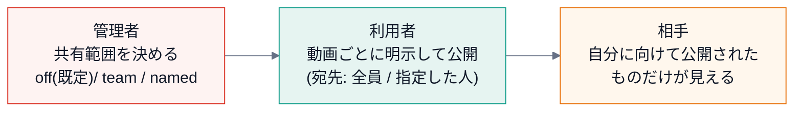

# 第 10 回 利用者・共有・プライバシー

> 所要時間の目安: 3 時間 / 前提: 第 9 回

## この回のゴール

- **利用者ごとにデータを分ける**(他人のデータが見えない)設計を説明できる。
- 共有を「**許可つき**」にする 3 つの段(管理者の範囲・利用者の公開・相手の限定)を説明できる。
- **入力の検証**(余計な項目を拒否する)が、プライバシーを守る仕組みであることが分かる。
- 「忘れる(forget)」と「削除(purge)」の違いを説明できる。

## 1. 設計の前提: 共有するものを、最初に決める

共有は、**何を共有しないか**を先に決めるのが肝心です。ChapterLens の方針:

| 共有する | 共有しない |
|---|---|
| **区間データ**(境界の時刻・長さ・利用者が選んだときの題名) | **字幕の全文・音声・動画** |

方針を、**コードの検証で強制**します(画面で「送らない」と決めるだけでは足りない。サーバーが、余計な項目を**受け付けない**)。

## 2. 3 つの段



- **既定は `off`**(誰も共有できない)。許可しない限り、動かない。
- **取り下げは、共有範囲が `off` でも、いつでもできる**(許可を引っ込めた後も、自分のデータを引き上げられる)。
- 停止された利用者の共有は、見えなくなる。

## 3. 入力の検証

```python
# 実行できる
from chapterlens.sharing import ShareError, validate_share

body = {"video": "abc123", "boundaries": [100, 300.5], "duration": 600, "audience": "team"}
ok = validate_share(body, mode="team", owner_id="u_1", active_ids={"u_1", "u_2"})
print("受理:", ok["boundaries"], ok["audience"])

bad = [
    ({**body, "transcript": "字幕の全文"}, "余計な項目(字幕)"),
    ({**body, "boundaries": [700]}, "動画の長さを超える境界"),
    ({**body, "titles": ["only one"]}, "題名の数が境界+1 と違う"),
    ({**body, "audience": ["u_zzzzzzzz"]}, "存在しない宛先"),
]
for b, why in bad:
    try:
        validate_share(b, mode="team", owner_id="u_1", active_ids={"u_1", "u_2"})
    except ShareError as e:
        print("拒否:", why, "→", e)

try:
    validate_share(body, mode="off", owner_id="u_1", active_ids=set())
except ShareError as e:
    print("共有範囲 off:", e)
```

```text
# 出力
受理: [100.0, 300.5] team
拒否: 余計な項目(字幕) → 共有できるのは区間データだけです(不要な項目: transcript)
拒否: 動画の長さを超える境界 → boundaries が duration を超えています
拒否: 題名の数が境界+1 と違う → titles は「章の数(境界の数 + 1)」個の配列です
拒否: 存在しない宛先 → 存在しない(または停止中の)利用者が含まれています
共有範囲 off: 共有は、管理者が無効にしています
```

- **許可した項目だけ**(`video`・`boundaries`・`titles`・`duration`・`audience`)を受け付け、**それ以外は拒否**します(「余計なものは無視」でなく「拒否」)。
  これは、**将来、画面の変更で字幕のかけらが紛れ込んでも、サーバーが止める**ための安全網です。
- 上限(境界は 500 個まで・題名 60 文字・宛先 50 人)も、**悪意でも事故でも**、巨大な入力を止めます。

## 4. 見える範囲

```python
# 引用: engine/src/chapterlens/sharing.py::ShareStore.visible
def visible(self, viewer: str, video: str, active_names: dict[str, str]) -> list[dict]:
    """viewer に見える共有(自分の・自分に向けて公開された・停止されていない人の)。"""
    with self._lock:
        rows = self.db.execute(
            "SELECT owner, boundaries, titles, duration, audience, shared_at FROM shares WHERE video_key=? ORDER BY shared_at DESC", (video,)
        ).fetchall()
    out = []
    for owner, b, t, dur, aud, at in rows:
        if owner not in active_names:
            continue
        audience = json.loads(aud)
        mine = owner == viewer
        if not (mine or audience == "team" or viewer in audience):
            continue
        out.append({"from": active_names[owner], "mine": mine, "boundaries": json.loads(b),
                    "titles": json.loads(t) if t else None, "duration": dur, "shared_at": at,
                    **({"audience": audience} if mine else {})})
    return out
```

読むポイント:

- **自分の共有は常に見える**。他人のものは、宛先が `team`(全員)か、**自分の ID を含む**ものだけ。
- `owner not in active_names` で、**停止された利用者**を除く。
- **自分の共有にだけ `audience` を付ける**。他人の公開範囲(誰に見せたか)は、教えない。

```python
# 実行できる
from chapterlens.sharing import ShareStore

s = ShareStore()
names = {"u_a": "alice", "u_b": "bob", "u_c": "carol"}
mk = lambda aud: {"video": "v", "boundaries": [100.0], "titles": None, "duration": 600.0, "audience": aud}
s.publish("u_a", mk("team"))           # alice: 全員に
s.publish("u_b", mk(["u_c"]))          # bob: carol にだけ

for viewer in ("u_a", "u_b", "u_c"):
    seen = sorted((x["from"], x["mine"]) for x in s.visible(viewer, "v", names))
    print(f"{names[viewer]:5s} に見えるもの:", seen)
print("bob が停止されたら carol に見える:", [x["from"] for x in s.visible("u_c", "v", {"u_a": "alice", "u_c": "carol"})])
```

```text
# 出力
alice に見えるもの: [('alice', True)]
bob   に見えるもの: [('alice', False), ('bob', True)]
carol に見えるもの: [('alice', False), ('bob', False)]
bob が停止されたら carol に見える: ['alice']
```

## 5. 利用者ごとの分離

修正(`corrections`)・共有・ライブのセッションは、**すべて `owner`(利用者 ID)をキー**に持ちます。クエリは常に `WHERE owner = ?`。
管理者であっても、API では**他人の修正は見えません**(分離は、役割より下の層)。

## 6. 忘れる(forget)と削除(purge)

| | 誰が | 何を消すか |
|---|---|---|
| `POST /v1/me/forget` | **本人** | 自分の修正・共有・ライブのセッション(利用者のアカウントは残る) |
| `admin purge <ID>` | **管理者** | 利用者のアカウントと、その修正・共有(**元に戻せない**。`--yes` が要る) |

どちらも監査ログに残りますが、**中身(題名・字幕)は残しません**。拡張の「共有と管理」ページの「自分のデータをすべて忘れる」は、さらに**ブラウザ側の調整**(`chrome.storage.local`)も消します。

## 確認問題

1. サーバーが「余計な項目を無視」でなく「拒否」するのは、なぜですか。
2. 共有範囲が `off` のとき、取り下げができるのはなぜですか。
3. alice の共有を、宛先に入っていない bob が見ようとすると、何が返りますか。
4. 管理者でも、他人の修正が API で見えないのは、どの層の仕事ですか。
5. 「忘れる」と「purge」の違いは。

## 解答

1. 無視だと、将来 UI が誤って字幕を混ぜても**黙って通る**(保存されてしまう)かもしれない。拒否すれば、テストと利用者に**すぐ気づける**。
2. 許可を引っ込めたときに、すでに公開したものが**取り下げられない**状態になるのは、プライバシーの面で不適切だから。
3. 一覧に出ない(空)。「存在するが見せない」とも「存在しない」とも区別がつかない。
4. 保存の層(`owner` をキーにしたクエリ)。役割(管理者)の判定より下で、データそのものが分離されている。
5. 「忘れる」は本人が自分のデータだけを消す(アカウントは残る)。`purge` は管理者がアカウントごと消す(元に戻せない)。

## まとめ

- 共有するのは区間データだけ。字幕・音声・動画は、サーバーの検証が**受け付けない**。
- 共有は 3 段の許可(管理者の範囲・利用者の公開・宛先)。既定は共有しない。取り下げはいつでも。
- データは `owner` で分離し、監査ログには内容を残さない。
- 次の回は、ダイジェストとライブ(採点・状態機械・遅れの測定)。
