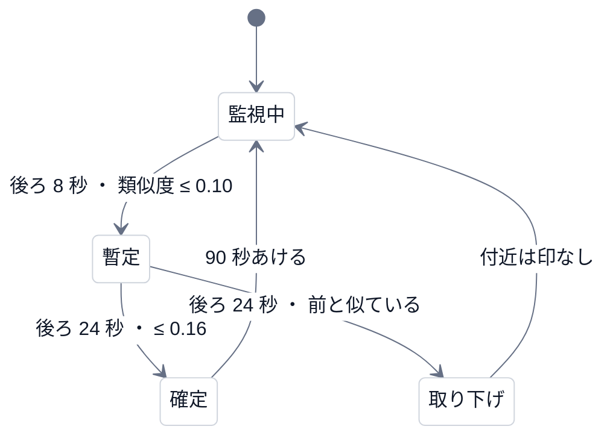

# 第 11 回 ダイジェストとライブ

> 所要時間の目安: 4 時間 / 前提: 第 4 回

## この回のゴール

- ダイジェストの**採点**(情報量・代表性・導入)と、**予算の中で選ぶ**手順を説明できる。
- 「重要」に正解が無いとき、どう**評価する**かを説明できる(利用者の調整との一致率)。
- ライブ検出の**状態機械**(暫定 → 確定 / 取り下げ)と、**遅れ**を測る方法を説明できる。
- 数値(窓・しきい値)を**仮**として扱い、**実測で決める**姿勢が分かる。

## 1. ダイジェスト: 「飛ぶ」だけで、切り出さない

目的は、長い動画の**重要そうな所だけ**を、再生しながら自動で飛ばして見ることです。他人の動画は**切り出さない**ので、作るのは「**区間のリスト**」だけです。

### 1.1 採点

字幕を **15 秒のかたまり**に分け、3 つの手がかりで点をつけます。

| 手がかり | 意味 | 重み |
|---|---|---|
| 情報量 | そのかたまりの語の重み(TF-IDF)の合計。固有の語が多いほど高い(相づち・つなぎは低い) | 0.5(最大を 1 に) |
| 代表性 | 同じ**章の「他のかたまり」**との重なり(コサイン類似度)。章の中心の話ほど高い | 0.5 |
| 導入 | 章の**最初**のかたまりに加点(章の話題を言い切ることが多い) | +0.25 |

### 1.2 選ぶ

1. **各章の最高点**を 1 つずつ(章を飛ばさない)。
2. 残りを**点の高い順に、予算**(動画の長さの 20%)まで。
3. 1 つだけ空いたすき間は埋め、連続したかたまりを 1 区間にまとめる。区間の始まり・終わりは、**発話の頭と終わり**に合わせる。

```python
# 実行できる
from chapterlens.captions import Cue
from chapterlens.digest import select_digest, total_seconds

A = ["guitar", "string", "chord", "melody", "tuning", "plectrum", "fretboard", "rhythm"]
B = ["recipe", "vegetable", "knife", "broth", "miso", "saucepan", "simmer", "seasoning"]
C = ["weather", "forecast", "typhoon", "humidity", "pressure", "rainfall", "temperature", "front"]
cues = []
for k, t in enumerate(range(0, 900, 6)):
    words = A if t < 300 else B if t < 600 else C
    text = " ".join(words[(k + j * 3) % len(words)] for j in range(5))
    if k % 5 == 0:
        text = "yeah okay right well"                 # 相づちだけの字幕(語が無い)
    cues.append(Cue(float(t), float(t + 6), text))

edges = [0.0, 300.0, 600.0, 900.0]                     # 3 つの章の境目
spans = select_digest(cues, [300.0, 600.0], 900.0, ratio=0.2)
for s in spans:
    touched = [i for i in range(3) if s["start_s"] < edges[i + 1] and s["end_s"] > edges[i]]
    print(f"{s['start_s']:6.1f}–{s['end_s']:6.1f} 秒  かかる章 {touched}  点 {s['score']}")
print("合計:", total_seconds(spans), "秒 / 動画 900 秒(予算は 20% = 180 秒。すき間埋めで増える)")
```

```text
# 出力
   0.0–  78.0 秒  かかる章 [0]  点 1.0
 228.0– 378.0 秒  かかる章 [0, 1]  点 1.0
 600.0– 618.0 秒  かかる章 [2]  点 1.0
合計: 246.0 秒 / 動画 900 秒(予算は 20% = 180 秒。すき間埋めで増える)
```

3 つの章のどれにも、区間がかかっています(章を飛ばさない)。2 つ目の区間は、1 つ空いたすき間を**埋めて 1 つにまとめた**結果、章の境目(300 秒)をまたいでいます。
結果の `chapter` の値は、区間の**最初**のかたまりが属する章で、またぐ区間では、その章だけが入ります。

### 1.3 評価: 「重要」の正解は人による

「重要」の正解は、**人によって違い、評価データにもありません**。だから、設計書の完了基準は「**利用者の修正で評価できる**」でした。
拡張で、区間を外す・足す**調整**をすると、自動案との**時間の重なりの F1**(一致率)が出ます。

```python
# 引用: engine/src/chapterlens/digest.py::agreement
def agreement(auto: list[dict], reference: list[dict]) -> dict:
    """自動の区間と、利用者が調整した区間(正解)の、時間での一致。precision = 自動のうち正解と重なる割合、
    recall = 正解のうち自動が拾えた割合。どちらかが空なら、その側は 0(両方空は 1)。"""
    a = _merge([(s["start_s"], s["end_s"]) for s in auto])
    r = _merge([(s["start_s"], s["end_s"]) for s in reference])
    la, lr = sum(y - x for x, y in a), sum(y - x for x, y in r)
    inter = 0.0
    i = j = 0
    while i < len(a) and j < len(r):
        lo, hi = max(a[i][0], r[j][0]), min(a[i][1], r[j][1])
        if hi > lo:
            inter += hi - lo
        if a[i][1] < r[j][1]:
            i += 1
        else:
            j += 1
    if la == 0 and lr == 0:
        return {"precision": 1.0, "recall": 1.0, "f1": 1.0}
    p = inter / la if la else 0.0
    rc = inter / lr if lr else 0.0
    f1 = 2 * p * rc / (p + rc) if p + rc else 0.0
    return {"precision": round(p, 4), "recall": round(rc, 4), "f1": round(f1, 4)}
```

```python
# 実行できる
from chapterlens.digest import agreement

auto = [{"start_s": 0, "end_s": 30}, {"start_s": 100, "end_s": 130}]
user = [{"start_s": 0, "end_s": 30}, {"start_s": 200, "end_s": 240}]   # 2 つ目を、別の区間に変えた
print(agreement(auto, user))
```

```text
# 出力
{'precision': 0.5, 'recall': 0.4286, 'f1': 0.4615}
```

適合率 0.5(自動案の半分が、利用者の区間と重なる)、再現率 0.43(利用者の区間のうち、自動が拾えた割合)。
**人の判断との一致は、まだ測っていません**(調整された区間が集まっていない)。測る道具(`digest-eval`)だけが用意してあります。

## 2. ライブ: 待たずに、2 段で出す

バッチの検出は、境界の**後ろ 80 秒**の文脈を使います。ライブでは、そこまで待てません。しかし、**境界は、直後の文脈が来ないと確実には決められません**(話題が変わったのか、脱線なのか)。
そこで、**速くする**のでなく、**2 段で扱います**。



- **暫定**(`tentative`): 早く出す。間違いうる。画面では「仮」。一度に 1 つだけ。
- **確定**(`committed`): 後ろの 24 秒を見て、位置を「**変化の始まり**」へ置き直して確かめる。**時刻は、変化の始まりに戻して付く**(確定が遅れても、打刻は遅れない)。

```python
# 引用: engine/src/chapterlens/live.py::LiveParams
@dataclass
class LiveParams:
    pre_s: float = 60.0  # 境界の前の窓
    tentative_s: float = 8.0  # 暫定の判定に要る、境界の後ろの長さ(字幕が届く遅れで、実際の遅れは中央値 10 秒前後)
    commit_s: float = 24.0  # 確定に要る、境界の後ろの長さ(30 秒でも F1 は同じ。24 秒で、確定までの遅れの中央値が 27 秒)
    refine_s: float = 10.0  # 確定のとき、位置を置き直す範囲
    min_gap_s: float = 90.0  # 境界どうしの最小の間隔(60 秒だと、区間数が正解の 2 倍を超える)
    tentative_sim: float = 0.10  # これ以下なら、暫定の印を打つ
    commit_sim: float = 0.16  # 確定の判定(後ろ commit_s 秒との類似度がこれ以下)
    min_tokens: int = 6  # 窓の中の語がこれより少ないと判定しない(無音・相づちだけの区間)
    horizon_s: float = 180.0  # 暫定を探す範囲(いまから、これより前は見ない)
    dismiss_radius_s: float = 15.0  # 取り下げた付近は、もう印を打たない
    max_cues: int = 20000
    max_density: int = 40  # 前後 10 秒(計 20 秒)に入れる字幕の数の上限。実際の発話は多くても 10 個ほど。計算量の暴走を防ぐ
```

```python
# 実行できる
from chapterlens.captions import Cue
from chapterlens.live import replay

A = ["guitar", "string", "chord", "melody", "tuning", "plectrum", "fretboard", "rhythm"]
B = ["recipe", "vegetable", "knife", "broth", "miso", "saucepan", "simmer", "seasoning"]
cues = []
for k, t in enumerate(range(0, 600, 4)):
    words = A if t < 300 else B
    cues.append(Cue(float(t), float(t + 4), " ".join(words[(k + j * 3) % len(words)] for j in range(5))))

det = replay(cues)       # 字幕を、終わりの時刻の順に 1 つずつ届ける(本番と同じ)
for m in det.committed:
    print(f"境界 {m['t']:.0f} 秒  暫定が出たのは {m['tentative_at']:.0f} 秒(+{m['tentative_at'] - m['t']:.0f})  確定は {m['committed_at']:.0f} 秒(+{m['committed_at'] - m['t']:.0f})")
```

```text
# 出力
境界 300 秒  暫定が出たのは 308 秒(+8)  確定は 324 秒(+24)
```

話題が変わった 300 秒の、**8 秒後**に暫定が出て、**24 秒後**に確定しています。この合成の字幕は、4 秒ごとにきれいに届くので、窓の長さ(8 秒・24 秒)どおりです。
**実データでは、字幕が話し終わってから届く遅れが上乗せされ**、中央値が 9 秒・27 秒になります(次の節)。

## 3. 遅れとずれの測り方

評価データ 39 本の字幕を**時間順に流し込み**、投稿者のチャプターの ±30 秒以内に対応づいた境界について、次を測りました(`live-eval`)。

| 指標 | 中央値 | 90 パーセンタイル | 目標(仮) |
|---|---:|---:|---|
| 暫定の印が出るまで(変化から) | 9.0 秒 | 16.9 秒 | 10 秒以内 |
| 確定するまで | 27.0 秒 | 33.9 秒 | 30 秒以内 |
| 確定での置き直しのずれ | 0.0 秒 | 7.0 秒 | CH2 以内 |

- **中央値では目標を満たす**が、**90 パーセンタイルは超える**。「平均的には」と「悪い方では」を分けて見る。
- パラメータ(窓 8 / 24 秒・類似度 0.10 / 0.16・最小間隔 90 秒)は、**39 本で決めた**ので、少し楽観的(データを半分にすると、設定による差は ±0.03〜0.04 のばらつきに収まる)。
- **本物のライブ配信(認識の遅れ・誤り・雑音)では未測定**。

## 4. 暴走を防ぐ

ライブのセッションは、利用者が送る字幕を**メモリに溜めて計算**します。悪意でも事故でも、重くならないよう、**上限**があります。

- 1 回に送れる字幕は 500 個。1 セッション 20000 個。
- 字幕の**密度**(20 秒に 40 個まで)。普通の発話は多くても 10 個ほど。
- 利用者ごとに同時 4 つ・2 時間使わなければ消える。**セッションごとの錠**(他の人を待たせない)。
- 「取り下げた位置」の記録は、探す範囲より古くなったら捨てる(増え続けない)。

## 確認問題

1. ダイジェストで「各章の最高点を 1 つずつ」先に選ぶのは、なぜですか。
2. ダイジェストの合計が、予算(20%)より多くなる理由を 2 つ挙げてください。
3. 暫定の遅れが、窓(8 秒)より大きくなるのはなぜですか。
4. 確定の時刻を「変化の始まりに戻して」付けるのは、なぜですか。
5. 中央値が目標を満たしても、90 パーセンタイルを併記するのはなぜですか。

## 解答

1. 点の高い章ばかりが選ばれ、**ある章が丸ごと飛ばされる**のを防ぐため。
2. すき間(1 つ空き)を埋めること。区間の終わりを、発話の終わりに合わせて延ばすこと。
3. 字幕は、話し終わってから**届く**ため。窓が溜まる時刻より、字幕が届く時刻が遅い。
4. 確定を待つ間に時間が経っても、**目次に付く位置は、実際に話題が変わった所**であってほしいから。打刻が遅れると、目次としては使えない。
5. 平均的な場合は良くても、**悪い場合に目標を超える**ことを隠さないため。使う側は、悪い方も知りたい。

## まとめ

- ダイジェストは、採点して、章ごとに 1 つ+予算まで選ぶ。評価は、利用者の調整との一致率。
- ライブは、速くするのでなく、**暫定と確定の 2 段**で扱う。時刻は変化の始まりに戻す。
- 数値は仮。実測で決め、**中央値と悪い方**の両方を報告する。
- 入力に上限を付けて、暴走を防ぐ。
- 次の回は、書き出し(EDL・字幕・ffmpeg)と、権利の関門。
