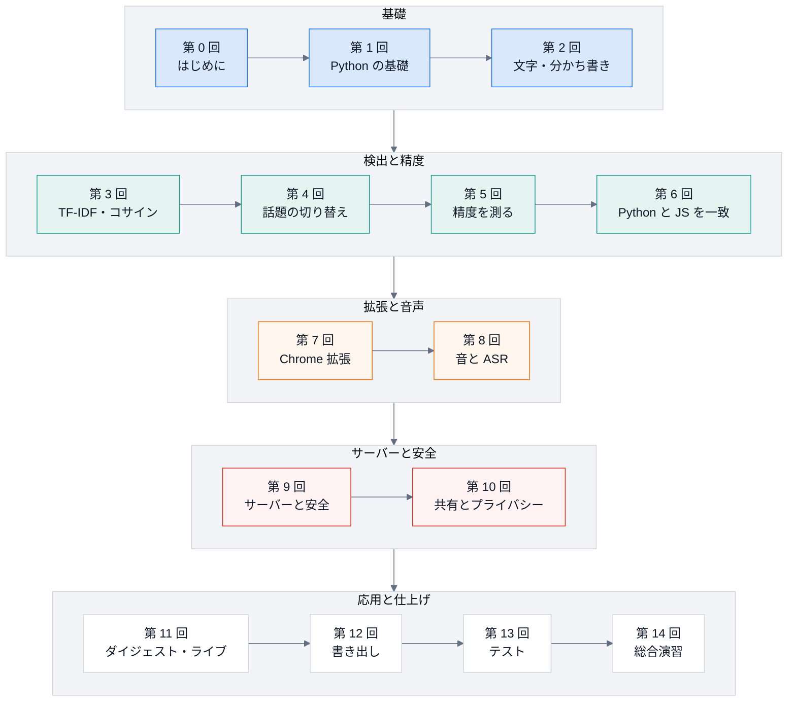

# 講義資料: 話題の切り替えを見つけ、安全に使う道具を、基礎から作る

ChapterLens を題材に、**基礎から、保守・拡張できるところまで**を、講義の形で学ぶ資料です。
Python の基礎・文字と語・TF-IDF・検出のアルゴリズム・精度の測り方・JavaScript との一致・Chrome 拡張・音声・サーバーと安全・共有・ダイジェストとライブ・書き出し・テストを、
「実際に動いているコード」を読みながら順に積み上げます。

## この講義の特徴

- **実際のコードを読む**。講義の引用は、リポジトリのソースから**自動で**作っています(`python tools/quote_code.py docs`)。コードが変わって説明が古くなると、テストが失敗します。
- **実行できる例には、実行結果が付く**。`# 実行できる` のコードは、テストが本当に 2 回実行し、`# 出力` の内容と一致することを確かめています。**手で写した出力はありません**。
- **各回に確認問題と解答**。読むだけで終わらず、自分で書いて確かめます。
- **図で説明する**。流れ・順序・状態・依存を、Mermaid の図(GitHub でもそのまま描かれる)と、構成図(SVG)で示します。
- **正直に書く**。測っていないこと・未確認のことは、そう書いてあります。

## 学習の地図

## 目次

| 回 | 題 | 目安 | 学ぶこと |
|---|---|---|---|
| [0](00-introduction.md) | はじめに | 1 時間 | 何を作る道具か・全体の構成・動かす |
| [1](01-python-basics.md) | Python の基礎 | 3 時間 | `dataclass`・`Counter`・`bisect`・純粋な関数・例外 |
| [2](02-text-processing.md) | 文字・正規表現・分かち書き | 3 時間 | UTF-8・正規表現・文字の 2 つ組(bigram) |
| [3](03-tfidf-cosine.md) | 語の重みとコサイン類似度 | 3 時間 | TF・IDF・コサイン類似度を手計算で |
| [4](04-topic-shift.md) | 話題の切り替えを見つける | 4 時間 | 類似度の曲線・谷の深さ・選択・置き直し |
| [5](05-evaluation.md) | 精度を測る | 3 時間 | 対応づけ・F1・基準・過学習 |
| [6](06-python-js-parity.md) | Python と JavaScript を同じ結果に | 3 時間 | 丸め・並べ替え・golden・UMD |
| [7](07-chrome-extension.md) | Chrome 拡張の仕組み | 4 時間 | Manifest V3・メッセージ・権限・通信の閉じ込め |
| [8](08-audio-and-asr.md) | 音の基礎と、文字にするまで | 4 時間 | PCM・WAV・チャンク・時計と再生位置・ASR |
| [9](09-server-and-security.md) | ローカルサーバーと安全設計 | 4 時間 | token・Origin・レート制限・監査ログ |
| [10](10-roles-and-sharing.md) | 利用者・共有・プライバシー | 3 時間 | 分離・許可つきの共有・検証 |
| [11](11-digest-and-live.md) | ダイジェストとライブ | 4 時間 | 採点・予算・状態機械・遅れの測定 |
| [12](12-export.md) | 書き出し | 3 時間 | EDL・SRT・ffmpeg・権利の関門 |
| [13](13-testing.md) | テストの戦略 | 3 時間 | 層ごとの方法・差し替え・不安定なテスト |
| [14](14-capstone.md) | 総合演習 | 半日 | 検出器を足して、測って、判断する |

## 進め方

- 手を動かしながら読む。`# 実行できる` のコードは、そのまま貼って実行できる(`cd engine && uv run python`)。
- 各回の「確認問題」は、**解答を見る前に**考える。
- 講義のあと、実務(直す・足す・壊れたときの調べ方)は、[学習資料(保守・拡張)](../learn/index.md) へ。
